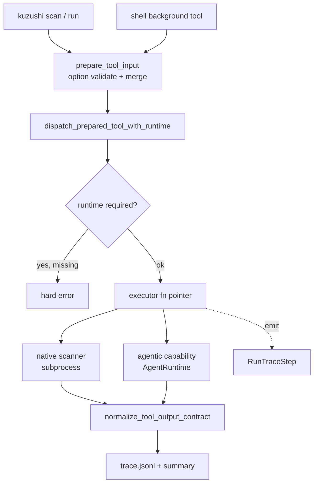
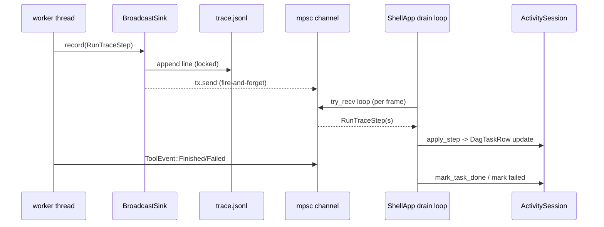
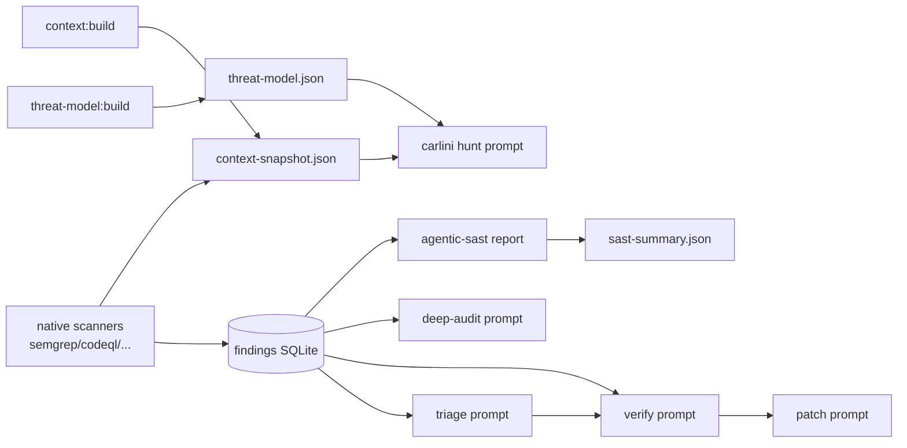
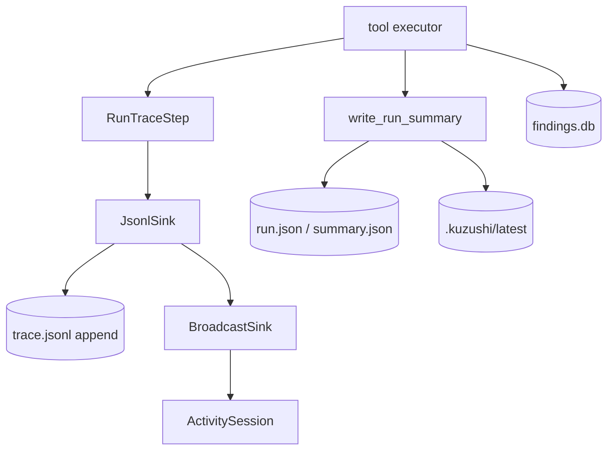

# Kuzushi — Prompt, Scan-Module & Runtime Architecture Audit

**Repository:** `allsmog/Kuzushi` (local working copy)
**Mode:** Read-only architecture extraction. No files modified, no code patched, no commits made.
**Method:** Static inspection of the Rust workspace (`crates/*`), docs, and on-disk `.kuzushi/` artifacts via `rg`/`ls`. Claims below are grounded in observed source; where a fact could not be fully confirmed statically it is marked **requires verification**.

> This report describes what exists. It does **not** claim the system is correct, complete, or fixed, and it contains no remediation plan.

---

## 1. Executive Summary

Kuzushi is a Rust security-agent workspace. Live product behavior runs through a single Rust dispatch boundary (`ModuleRegistry::prepare_tool_input` → `dispatch_prepared_tool_with_runtime`) shared by three modes (`scan`, interactive shell/TUI, headless `run`). A retained TypeScript SDK under `src/` is a compatibility/export surface, not the runtime.

**Prompt architecture.** Prompts are overwhelmingly **embedded Rust string constants** (roughly two dozen `*_SYSTEM_PROMPT` / `*_PROMPT` consts across `kuzushi-core` and `kuzushi-openai`). There is **no `include_str!` of prompt files** into the live path — the only `include_str!` uses are test fixtures and an Android APK code-scan asset. Prompts are therefore sealed at compile time. A runtime **override layer** (`.kuzushi/prompts/<module>/<verb>.md` files, `*_PROMPT` tool options, and a prompt-mutation approval store) sits in front of the compiled defaults. Runtime requests are assembled into `AgentQueryRequest` / `AgentToolLoopRequest`, dispatched through an `AgentRuntime` trait implemented by a LangGraph bridge (`kuzushi-openai`), and wrapped by a `TracedRuntime` that fingerprints each call with `prompt_pair_hash`. Structured output is enforced by appending a JSON-schema contract to the system prompt and running a parse→validate→repair loop.

**Scan modules.** Modules are `BuiltinModule` descriptors (`ToolDescriptor` + `OptionSpec` + optional `DagNodeDescriptor`) registered into a `ModuleRegistry` at startup (`with_v2_builtins`). Native scanners (semgrep, codeql, iac, cargo-audit, govulncheck, license, sbom, exploit-chain, android-apk) are Rust executors that shell out to / wrap external tools and persist findings to a SQLite findings store. Agentic modules (triage, verify, patch, taint-iris, threat-model, deep-audit, carlini-threat-hunt, agentic-sast, x-ray, full-mode) require an `AgentRuntime`.

**Runtime & persistence.** Background tools run on `thread::spawn`ed workers that emit `ToolEvent` and `RunTraceStep` over `mpsc` channels. The TUI drains these once per frame into an `ActivitySession` of `DagTaskRow`s. Durable state lives under `.kuzushi/`: run summaries (`summary.json` / `run.json`, atomic write + `latest` pointer), append-only `trace.jsonl` (per-path mutex + `OpenOptions::append`), per-stage `triage.jsonl` / `verify.jsonl`, findings SQLite DB, and context snapshots. Coupling between prompts and scans is real and multi-stage: findings and context snapshots produced by scanners become prompt inputs for later triage/verify/hunt stages.

The architecture is cohesive and well-separated, but several **architectural assumptions** (single-writer run summaries, trace append durability without fsync, static context-snapshot freshness, override precedence across three sources) warrant runtime confirmation. See §14.

---

## 2. Prompt Inventory

Classification legend: **E** embedded string · **O** overrideable · **G** generated/composed at runtime · **D** documentation-only · **T** test/demo.

| Prompt Surface | Location | Form | Runtime Consumer | Inputs Interpolated | Expected Output | Notes |
|---|---|---|---|---|---|---|
| `TRIAGE_SYSTEM_PROMPT` | `kuzushi-openai/src/langgraph_runtime/triage.rs` | E / O | `triage_finding_blocking` | compact finding JSON | JSON `{verdict, confidence, rationale}` | Override key `TRIAGE_PROMPT`; parsed to `TriageOutcome`; hashed + traced |
| `VERIFY_SYSTEM_PROMPT` | `kuzushi-core/src/verification/adapters/verify_finding_input.rs` | E / O | verify tool | finding + code context | JSON verification result (exploitable, poc, confidence) | Override key `VERIFY_PROMPT`; schema embedded inline |
| `PATCH_SYSTEM_PROMPT` | `kuzushi-core/src/remediation/patch/from_tool_input.rs` | E / O | patch tool | finding context | JSON `{diff, explanation}` | Unified-diff contract |
| `SYSTEM_PROMPT` (carlini) | `.../capabilities/carlini_threat_hunt/domain/tool_contract.rs` | E / O / G | carlini hunt (per actor) | threat model, actor, flows, scan-scope guard | JSON finding list | Override `CARLINI_THREAT_HUNT_PROMPT`; documented in `docs/carlini-threat-hunt-prompts.md` |
| `VARIANT_HUNT_/SIGNATURE_/NDIFF_* PROMPT` (4) | `.../capabilities/variant_ndiff/domain/cve_patch_ref.rs` | E | variant hunt | CVE patch ref + target | variant findings | Four related prompts |
| `X_RAY_SYSTEM_PROMPT` | `.../capabilities/x_ray/application/run_request.rs` | E | x-ray run | code inventory | structured analysis | — |
| `AGENTIC_SAST_SYSTEM_PROMPT` | `.../capabilities/agentic_sast/application/run_agentic_sast_report.rs` | E | agentic-sast | findings + evidence | JSON report | parent/child trace steps |
| `UAF_HUNT_SYSTEM_PROMPT` | `.../capabilities/uaf_hunt/application/build_uaf_hunt_prompt.rs` | E / G | uaf hunt | code context | findings | — |
| `TAINT_CWE_SELECT_/TAINT_IRIS_SYSTEM_PROMPT` (2) | `.../capabilities/taint_iris/domain/tool_contract.rs` | E | taint-iris hunt | CWE catalog, flows | JSON flows/findings | emits structured `data.flows[]` |
| `TAINT_IRIS_NEXT_SYSTEM_PROMPT` | `.../capabilities/taint_iris_next/domain/prompt.rs` | E | taint-iris-next | finding review | structured review | — |
| `THREAT_MODEL_SYSTEM_PROMPT` | `.../capabilities/threat_model/application/read_threat_model.rs` | E | threat-model build | inventory + DFD | JSON threat graph | tool-loop |
| `CLASSIFIER_SYSTEM_PROMPT` | `.../capabilities/classifier_gate/application/classifier.rs` | E | classifier gate | candidate | classification | gate |
| `DEFAULT_SYSTEM_PROMPT` (deep auditor) | `.../capabilities/deep_auditor/domain/contract.rs` | E / O | deep-audit tool loop | finding + whitebox evidence | JSON vuln analysis | ~148-line prompt; `temperature=0.0`; config-overrideable `system_prompt` |
| `SYSTEM_PROMPT_C / _UNKNOWN` (2) | `.../capabilities/full_mode_multi/application/chunk_prompt.rs` | E / G | full-mode hunt | code chunks | findings | language-specialized |
| `WHITEBOX_STATIC_TRIAGE_SYSTEM_PROMPT` (+ block) | `.../proof/whitebox_policy/policy_contract.rs` | E | whitebox triage | static proof state | triage | — |
| `ASK_SYSTEM_PROMPT` | `kuzushi-tui/src/app/with_next_step.rs` | E | shell `ask` | user question + context | text | interactive |
| `PLAN_SYSTEM_PROMPT` | `kuzushi-tui/src/app/workers/tool_run_status.rs` | E | `/plan` planner | NL goal | JSON plan | shell-only |
| `THREAT_PATCH_SYSTEM_PROMPT` | `kuzushi-tui/src/app/workers/parse_plan_json.rs` | E | threat patcher | threat + finding | JSON patch | shell-only |
| `docs/all-prompts.txt` (1090 lines) | `docs/` | D | none (reference) | — | — | Catalogs ~53 prompts incl. legacy Node system; **provenance/currency requires verification** |
| `docs/carlini-threat-hunt-prompts.md` | `docs/` | D | none (reference) | — | — | Documents carlini runtime prompt composition |
| `.kuzushi/prompts/<module>/<verb>.md` | user workspace (not in repo) | O | override resolver | — | replaces default | See §4 |

**Structured-output contract text** is not itself a prompt asset but is appended to every system prompt that requests JSON — see `append_structured_output_contract` in `kuzushi-core/src/runtime/domain/agent_query.rs` (§6).

---

## 3. Prompt Construction Pipeline

```
Tool input (JSON options)  ──►  prepare_tool_input (registry, option validation/merge)
   │
   ├─► prompt source selection
   │     • .kuzushi/prompts/<module>/<verb>.md  (file override)
   │     • *_PROMPT option value in tool input
   │     • compiled *_SYSTEM_PROMPT constant     (fallback)
   │
   ├─► context / artifact injection
   │     • finding JSON (compacted/truncated)
   │     • context-snapshot.json, threat-model.json
   │     • prior-stage findings from SQLite store
   │
   ├─► request assembly → AgentQueryRequest / AgentToolLoopRequest
   │     • system_prompt (+ append_structured_output_contract)
   │     • prompt (user message), model, thinking_level, temperature, tool_policy
   │
   ├─► runtime call → AgentRuntime::query_blocking / next_step_blocking / triage_finding_blocking
   │     (TracedRuntime wraps: records prompt_pair_hash, latency_ms, cost_usd)
   │
   ├─► response parsing → structured_json_contract: parse → validate → repair loop
   │
   ├─► local state update → Finding / TriageOutcome / patch / threat graph
   │
   └─► trace / summary / artifact write → trace.jsonl, summary.json/run.json, per-stage jsonl
```

Responsible code:

- **Select / compose:** `kuzushi-core/src/modules/application/sast_scan/prompt_overrides.rs`; `kuzushi-core/src/options/prompt_override.rs` (`resolve_prompt_override_for_key`).
- **Request types:** `kuzushi-core/src/runtime/domain/agent_query.rs` (`AgentQueryRequest`, builders `with_thinking_level`, `with_structured_output`, `with_temperature`); `.../runtime/domain/tool_loop.rs` (`AgentToolLoopRequest`).
- **Runtime trait:** `.../runtime/domain/agent_runtime.rs` (`query_blocking`, `next_step_blocking`, `triage_finding_blocking`, `spawn_subagent_blocking`).
- **Bridge impl:** `kuzushi-openai/src/langgraph_runtime/runtime_impl.rs` (resolves thinking level, appends contract, dispatches to Python bridge).
- **Fingerprint / trace metadata:** `kuzushi-core/src/runtime/traced_runtime/metadata.rs` (`prompt_pair_hash`, `model_provider`) and `.../traced_runtime.rs`.
- **Parse / repair:** `kuzushi-core/src/structured_output/structured_json_contract.rs`.

---

## 4. Prompt Override & Configuration Model

| Override Mechanism | Location | Scope | Precedence | Runtime Consumer | Persistence Model |
|---|---|---|---|---|---|
| File override `.kuzushi/prompts/<module>/<verb>.md` | workspace `.kuzushi/prompts/` | per module+verb | **highest** (checked first) | `prompt_overrides.rs`, `prompt_override.rs` | on-disk markdown, user-owned |
| Tool-input `*_PROMPT` option | tool input JSON | per invocation | next | `verify_finding_input.rs`, carlini input options | ephemeral (request only) |
| Compiled `*_SYSTEM_PROMPT` const | Rust source | per module | **fallback** | executor | sealed at compile time |
| Prompt-mutation approval store (`prompt-mutations.jsonl`) | `kuzushi-core/src/prompt_stack/`; TUI `prompts/tune_action_count/house_rules.rs` | per module+verb | gates launch | background tool launch (`background.rs`) | append JSONL, sha256 per entry, status Pending/Approved/Rejected |
| House-rules text | `.kuzushi/house_rules/<module>.md` (**requires verification** of exact path) | per module | injected/hashed | TUI house_rules reader | on-disk; fingerprint recorded in run metadata |
| `thinking_level` | `RuntimeConfig.thinking_level` + per-request `with_thinking_level` | global / per-request | request overrides config | `runtime_impl.rs` | config file + request |
| `temperature` | request field; deep-auditor default 0.0 | per-request | request | provider | request only |
| Model / tier | `AgentQueryRequest.model`; `model_for_tier` | per-request | request | bridge | config + request |

**Ambiguity risk:** the same effective prompt for one module+verb can be shaped by **three independent sources** (file override, `*_PROMPT` option, compiled default) plus a **fourth gate** (prompt-mutation store that can *block* a launch entirely). Whether the file override or the `*_PROMPT` option wins when both are present is asserted by the agents as "file → input → default" in `prompt_overrides.rs` but the exact ordering **requires verification** per consuming module, since some modules resolve the `*_PROMPT` option value *through* the same path resolver (a value that looks path-like is loaded as a file). This is a genuine precedence-clarity risk.

---

## 5. Prompt Data Dependencies

| Prompt Consumer | Data Sources | Serialization | Freshness Assumption | Failure Behavior |
|---|---|---|---|---|
| Triage | compact finding (title≤300, message≤2000, ≤5 evidence @600 chars; HTTP blobs replaced by presence markers) | JSON | finding current at triage time | parse fail → `TriageOutcome{NeedsReview, conf 0.25, rationale=error}` (non-fatal fallback) |
| Verify | finding + code context | JSON | finding + source on disk current | structured repair loop; truncation → explicit error, no finding |
| Patch | finding context | JSON | finding current | repair loop; failure surfaces error |
| Carlini hunt | threat-model doc, actor, flows/guards/sanitizers, scan-scope guard | JSON + templated text | **assumes upstream DAG threat-model output present** | override key; **requires verification** of missing-artifact behavior |
| Deep auditor | finding + whitebox static evidence (from findings DB), registry/evidence graph | text + JSON | whitebox evidence indexed before run | tool-loop; per-step metadata |
| Threat model | code inventory + DFD | JSON | inventory built at run start | tool-loop |
| Full-mode | code chunks | text | chunk read at call | per-chunk |

**Flagged:** context snapshots (`.kuzushi/context-snapshot.json`) are built at scan start and **reused across modules with no visible cache-invalidation**, so a long multi-stage run can inject a stale snapshot into a later prompt (**architectural assumption — requires verification**). Prompts that consume prior-stage findings assume those findings were persisted and are queryable by `scan_id`.

---

## 6. Structured Output & Parsing Audit

| Runtime Path | Expected Output | Parser | Validation | Fallback | State Impact |
|---|---|---|---|---|---|
| Any `structured_output` request | strict JSON per named schema | `structured_output/structured_json_contract.rs` (`parse_and_validate`, `structured_json_value`) | schema + validator closure; contract appended to system prompt | build repair prompt, re-`query_blocking`; if repair fails → error w/ both raw responses | on success value → state; on failure no state advance (except triage) |
| Triage | `{verdict, confidence, rationale}` | `langgraph_runtime/triage.rs` | inline | **soft fallback** `NeedsReview @0.25` | **can advance state with a defaulted verdict** |
| Verify | verification JSON | `verify_finding_input.rs` | inline schema | truncation → error, no finding | blocks finding creation on failure |
| Patch | `{diff, explanation}` | `remediation/patch/from_tool_input.rs` | inline | repair loop | error surfaces |
| Truncated response | — | `structured_json_contract.rs` | detects `response.truncated` | bail with token-budget error incl. partial output | partial output **not persisted** |

Key behaviors: the JSON schema is embedded into the system prompt (`append_structured_output_contract`); a failed parse triggers **one repair round-trip** reusing the same system prompt/schema/thinking level; malformed output is generally **not persisted** and does **not** advance the state machine — **except triage**, which substitutes a low-confidence `NeedsReview` verdict and continues. That triage soft-fallback is the one place where unparsed model output produces a persisted, state-advancing default (**noted as a risk in §14**).

---

## 7. Scan Module Inventory

| Module / Scanner | Registration | Execution Fn | Input (options) | Output | Artifacts | Runtime Mode |
|---|---|---|---|---|---|---|
| semgrep | `native_scanners/register_modules.rs` → `semgrep_module.rs` | `run_semgrep_scan` | target, binary, mode, whiteboxStatic, staticProofState, config | `SemgrepScanReport` | findings SQLite, static evidence, trace steps | subprocess-backed, deterministic (no runtime) |
| codeql | same | `run_codeql_scan` | target, dbPath, language, buildMode, suite, threads, ram… | `CodeqlScanReport` (+ SARIF) | findings + SARIF as static evidence | subprocess |
| iac-scan | same | `run_iac_scan` | target, options | findings | findings DB | subprocess/native |
| cargo-audit | same | `run_cargo_audit_scan` | target | dep findings | findings DB | subprocess |
| govulncheck | same | `run_govulncheck_scan` | target | dep findings | findings DB | subprocess |
| license-scan | same | `run_license_scan` | target, options | license findings | findings DB | native |
| sbom-scan | same | `run_sbom_scan` | target | `SbomScanReport` (components) | artifact | native |
| exploit-chain | same (`.deferred()`) | `run_exploit_chain_scan` | target, model | chains | artifact + `data.flows` | **requires runtime + explicit model** |
| android-apk (multi-verb) | same | `run_*` per verb | apk, env | manifest/network/code findings | findings | subprocess/native |
| triage | agentic register | `triage_finding_blocking` path | finding, `TRIAGE_PROMPT` | verdict | `triage.jsonl` | agentic |
| verify | agentic | verify tool | finding, `VERIFY_PROMPT` | exploitability | `verify.jsonl` | agentic |
| patch | agentic | patch tool | finding | diff | patch artifact | agentic |
| taint-iris / -next | `taint_iris_module.rs` | hunt | flows, CWE | `data.flows[]` findings | artifact | agentic |
| threat-model | `threat_model_module.rs` | build | inventory | threat graph | `threat-model.json` | agentic (tool-loop) |
| deep-audit | `deep_auditor` | tool loop | finding + evidence | vuln analysis | artifact | agentic |
| carlini-threat-hunt | capability | per-actor query | threat model, actors | findings | artifact | agentic |
| agentic-sast | capability | `run_agentic_sast_report` | findings | report | `sast-summary.json` | agentic (parent/child trace) |
| x-ray | `x_ray_module.rs` | `run_request` | inventory | analysis | artifact | agentic |
| full-mode | `full_mode_module.rs` | hunt | chunks | findings | artifact | agentic |
| recon | `recon_module.rs` | import/probe | tool exports | recon store | recon findings | native/importer |
| bounty/har/burp import | recon/bounty importers | import | capture file | http-request findings | findings | importer |

All DAG-participating executors emit at least `start` + `done` trace steps via `ctx.trace.step(...).emit()`; multi-phase agentic modules emit child reasoning steps. Native scanners persist to the findings store and mark whitebox-static evidence when enabled.

---

## 8. Module Registry & Dispatch Architecture

Registry: `kuzushi-core/src/modules/registry/module_registry.rs` — `ModuleRegistry { modules, tools, executors, dynamic_tools }`. `ToolExecutor` is a fn pointer `(&ModuleRegistry, &str, &Value, &ToolExecutionContext, Option<&dyn AgentRuntime>) -> Result<Value>`.

Descriptors: `modules/descriptor/descriptor_model.rs` — `ToolDescriptor` (name, description, headless, hidden, `runtime_requirement` ∈ {Never, Always, InputAware}, `options: Vec<OptionSpec>`), `DagNodeDescriptor` (id, output_kind, `depends_on`), `OptionSpec` (type, required, default, choices, aliases, deprecated_aliases). `BuiltinModule` bundles metadata + tools + dag_nodes.

Registration: `builtins/with_v2_builtins/builtin_registration.rs` — `with_v2_builtins()` registers foundation → workspace/catalog → security modules → plugin adapters → deferred adapters. `register()` inserts tools and DAG executors.

Dispatch: `builtins/with_v2_builtins/execution.rs` — `prepare_tool_input()` (resolve tool, validate/merge options) then `dispatch_prepared_tool_with_runtime()` (enforce runtime requirement, open scoped trace, look up executor by name, call it, normalize output via `normalize_tool_output_contract`). Dynamic `file://`/`package:` modules go through `dynamic_loader.rs` + the Node host script.



---

## 9. Scan Execution State Machines

**Full scan lifecycle** (`kuzushi-cli/src/application/scan.rs`, TUI `app/scan/start_scan/`): `prepare → dispatch (running) → record_tool_run_complete | record_tool_run_failed`. Durable side effects: `scan-input.json`, findings DB rows, `summary.json`/`run.json`, `latest`. In-memory: `ScanEvent::Stage` strings bridged into activity rows. Terminal: `Finished{run_id, findings_count, cost_usd}` / `Failed{error}`.

**Single-module lifecycle** (`execution.rs`): `resolve tool → validate options → enforce runtime → open trace scope → executor runs (emits start/…/done) → normalize output → persist artifacts`. Terminal: normalized `Value` or `Err`. Invariant: option validation and normalization always happen at this shared boundary regardless of mode.

**Background worker lifecycle** (`kuzushi-tui/src/app/tool_runner/run_tool/background.rs`, `workers/background_tool_worker.rs`): `start_background_tool` rejects overlap, checks pending prompt mutations, validates bridge, `prepare_background_tool_dispatch` creates two `mpsc` channels (`ToolEvent`, `RunTraceStep`), `attach()` stores receivers on `ShellApp`, `thread::spawn` runs `background_tool_worker` → `run_background_tool` → `dispatch_prepared_tool_with_runtime`, worker sends `ToolEvent::Finished|Failed`, main loop drains, receivers cleared when idle. Terminal states set `DagTaskRow.state` to `Done`/`Failing`.

```mermaid
stateDiagram-v2
    [*] --> Queued
    Queued --> Active: dispatched / first trace step
    Active --> Active: progress step
    Active --> Done: ToolEvent::Finished
    Active --> Failing: ToolEvent::Failed
    Active --> Canceled: cancel armed + abort
    Done --> [*]
    Failing --> [*]
    Canceled --> [*]
```

---

## 10. Scan Event & Frame Routing

Event enums: `RunTraceStep` (n, kind, verb, label, module_id, parent_step, started_at_ms, latency_ms, tool_name); `ScanEvent::{Stage(String), Finished{run_id, findings_count, cost_usd}, Failed{error}}`; `ToolEvent::{Finished{tool_name, result}, Failed{tool_name, error}}`.

Channels created at scan/tool start (`scan_startup.rs`: `mpsc::channel()` for events + `mpsc::channel::<RunTraceStep>()`). Trace fan-out uses `BroadcastSink` wrapping the `JsonlSink` plus a `Sender<RunTraceStep>` (writes file **and** forwards to UI; UI send is fire-and-forget `let _ = tx.send(...)`). Receivers held as `Option<Receiver<_>>` on `ShellApp` (`scan_rx`, `tool_rx`, `trace_rx`, `agent_rx`, `plan_rx`, `threat_rx`).

Drain order per frame (`background_events/drain_background_events/runtime_event_drains.rs`): scan → tool → agent → plan → threat → **trace last**. Each is a `try_recv()` loop. `drain_trace_events` feeds `ActivitySession::apply_step` (`app/view_state/activity.rs`), which resolves `(module_id, verb)` → task_id (collapsing doubled tails like `sast:scan:scan`), creates/updates a `DagTaskRow`, and pushes into a 2000-entry ring buffer. Free-form `ScanEvent::Stage` strings are bridged into synthetic trace steps (`scan_event_routing.rs`). Receiver teardown is conservative: `trace_rx` cleared only when scan + tool are both done and idle.



---

## 11. Artifact & Persistence Audit

| Artifact / State File | Writer | Reader | Format | Atomicity | Producer | Consumer |
|---|---|---|---|---|---|---|
| `summary.json` (legacy) + `run.json` (canonical) | `run_artifacts/run_summary_store.rs::write_run_summary` | `load_run_summary` | JSON | `fs_atomic::write_atomic` (temp+rename) | scan/tool completion | replay, findings CLI, TUI |
| `.kuzushi/latest` | `write_latest_run_id` | run resolvers | text (run_id) | atomic write | run completion | latest-run lookups |
| `trace.jsonl` | `write_run_artifact_json.rs::append_run_trace_step` | `llm_audit.rs`, replay | JSONL | per-path `Mutex` + `OpenOptions::append` + `write_all` (**no fsync**) | `JsonlSink`/`BroadcastSink` | Activity replay, LLM audit |
| step counter | `next_run_trace_step_number` + shared `AtomicUsize` per path | trace handles | in-memory + disk seed | atomic, disk-seeded on restart | trace handles | numbering |
| `triage.jsonl` / `verify.jsonl` | agentic stages | triage/verify readers | JSONL | append | triage/verify modules | SAST orchestration |
| `scan-input.json` | scan prepare | replay | JSON | atomic | scan start | reproducibility |
| findings SQLite DB | `findings/persistence/finding_store.rs` | `list_findings_for_scan_id` | SQLite | WAL (single writer) | scanners | later prompts, exports |
| `context-snapshot.json` | context build | modules | JSON | write | context module | many modules (see §5 freshness flag) |
| `threat-model.json` | threat-model build | carlini, others | JSON | write | threat-model module | downstream hunts |
| `sast-summary.json` | `modules/sast_run/write_sast_run_summary.rs` | SAST readers | JSON | `write_run_artifact_json` (atomic) | SAST | reports |
| `.artifacts` manifest | run_artifacts | artifact listing | JSONL | append | milestones | UI/exports |
| option store | `modules/options/` | `prepare_tool_input` | persisted | — | operator | dispatch |

**Architectural risks (flagged only):** trace appends are durable-ordered per path but **not fsync'd**, so a crash can lose the last line(s) — mitigated by treating the run summary as source of truth (**requires verification**). Run-summary single-writer is enforced by run_id uniqueness, **not a code guard**. Prompt-mutation JSONL has **no visible concurrent-write guard**. Observed run dirs vary (some contain `scan-input/summary/triage/verify` but not `trace.jsonl`/`run.json`), so artifact-set completeness per run is **not uniform** — consumers should not assume every file exists.

---

## 12. Prompt-to-Scan Coupling Map

| Prompt Runtime Path | Depends on Scan Output? | Scan Source | Artifact Source | State Source | Coupling Risk |
|---|---|---|---|---|---|
| Triage | yes | native scanner findings | findings DB | `scan_id` rows | finding must be persisted first; soft-fallback verdict |
| Verify | yes | prior findings | findings DB | finding + source | truncation aborts finding |
| Patch | yes | verified finding | findings DB | finding | depends on verify stage |
| Carlini hunt | yes | threat-model + scan | `threat-model.json` | DAG upstream | **assumes upstream artifact exists** (requires verification) |
| Deep auditor | yes | whitebox static evidence | findings DB / evidence store | indexed evidence | evidence must be indexed pre-run |
| Agentic-SAST report | yes | multiple sub-tool outputs | run dir artifacts | `report_from_data(...)` | reads each module's artifact by name |
| Threat-model build | partial | code inventory | context snapshot | inventory | snapshot freshness (§5) |
| Full-mode hunt | no (source only) | — | — | code chunks | — |

Multi-stage pattern (`sast_scan/from_tasks.rs`): native scanners run first and persist findings; agentic stages (agentic-sast, offense-review, taint-iris) then read prior artifacts by tool name via `SastSubtoolDispatch`. This is the principal coupling: **module output at stage N becomes prompt/report input at stage N+1**, mediated by the findings DB and per-run artifact files.

---

## 13. Test Coverage Map

| Area | Existing Tests (approx, agent-reported) | What They Cover | What They Do Not Prove |
|---|---|---|---|
| Persistence | `run_artifacts/tests.rs` (~138) | summary/trace/artifact writes, atomic write | torn/`trace.jsonl` crash recovery |
| Modules / dispatch | `modules/tests.rs` (~81) | dispatch, SAST orchestration, option validation | end-to-end agentic parse under malformed model output |
| TUI app / events | `app/tests.rs` (~334) | state, event drain, activity rows | cross-event ordering edge cases, late-event after teardown |
| Atomic FS | `fs_atomic.rs` (3) | concurrent same-process atomic write | multi-process contention |
| Snapshots/fixtures | ~16 files (tui/cli snapshots) | render models, CLI cutover, dep hygiene | prompt-output schema drift |
| **Total (reported)** | ~3700 | broad | — |

Counts are as reported by the exploration pass and **require verification** via `cargo test`. Notable gaps: no explicit torn-trace recovery test, prompt-mutation race not isolated, triage soft-fallback path coverage unconfirmed.

---

## 14. Architecture Risk Register

| Risk Area | Code Shape / Evidence | Why It Matters | Verification Needed |
|---|---|---|---|
| Prompt override precedence | three sources (file / `*_PROMPT` option / const) + mutation gate; path-like option values loaded as files | ambiguous which wins per module | trace override resolution per consuming module |
| Prompt drift vs. docs | `docs/all-prompts.txt` catalogs legacy Node prompts; live prompts are Rust consts | doc may misrepresent runtime | diff doc against compiled consts |
| Triage soft-fallback | `langgraph_runtime/triage.rs` returns `NeedsReview@0.25` on parse fail | malformed model output advances state with defaulted verdict | confirm downstream treatment of low-confidence verdicts |
| Stale context snapshot | `context-snapshot.json` built once, reused; no visible invalidation | long runs may inject stale data into later prompts | confirm snapshot lifecycle |
| Trace append durability | `OpenOptions::append` + lock, **no fsync** | crash can drop trailing trace lines | confirm summary-as-truth assumption under crash |
| Run-summary single writer | enforced by run_id uniqueness, not a guard | concurrent writers to one run_id could clobber | confirm no concurrent write path |
| Prompt-mutation JSONL race | append with no concurrency guard noted | approval-store corruption possible | confirm single-writer in practice |
| Artifact-set non-uniformity | observed run dirs missing some files | consumers assuming file presence may fail | enumerate required-vs-optional artifacts |
| Receiver teardown timing | `trace_rx` cleared only when scan+tool idle | late events after teardown could be dropped | confirm no producer outlives drain |
| DAG `depends_on` semantics | CLAUDE.md warns it may be display-only metadata | ordering assumptions may be false | confirm executor consumes `depends_on` |
| Structured schema drift | schema embedded in prompt; parser separate | prompt/schema and Rust parser can diverge | confirm shared source of truth |
| Exploit-chain runtime coupling | requires explicit model + runtime | missing model → hard error mid-scan | confirm pre-flight validation |

---

## 15. Diagrams

**Prompt construction & execution** — see §3 code block (linear pipeline) and §8 dispatch flow.

**Prompt → scan dependency flow:**



**Persistence flow:**



---

## 16. Open Questions

1. Which prompt catalog is canonical — the Rust `*_SYSTEM_PROMPT` constants or `docs/all-prompts.txt` (which appears to include legacy Node-era prompts)?
2. When both a `.kuzushi/prompts/<module>/<verb>.md` file **and** a `*_PROMPT` tool option are supplied, which takes precedence per module?
3. Is the `context-snapshot.json` intentionally single-shot per scan, and are downstream prompts expected to tolerate its staleness across long runs?
4. Is the trace `trace.jsonl` considered best-effort telemetry (losable on crash) with `run.json` as the durable source of truth?
5. Which per-run artifacts are *required* vs *optional*? Observed run directories are not uniform.
6. Does any executor actually consume `DagNodeDescriptor.depends_on` for ordering, or is it purely progress/display metadata (as CLAUDE.md cautions)?
7. Is the triage soft-fallback (`NeedsReview @0.25`) an intended state-advancing behavior, and how are such findings treated downstream?
8. Are run-summary and prompt-mutation writers guaranteed single-writer by construction, or only by convention (run_id uniqueness)?

---

*End of audit report. No files were modified; no remediation was performed.*
