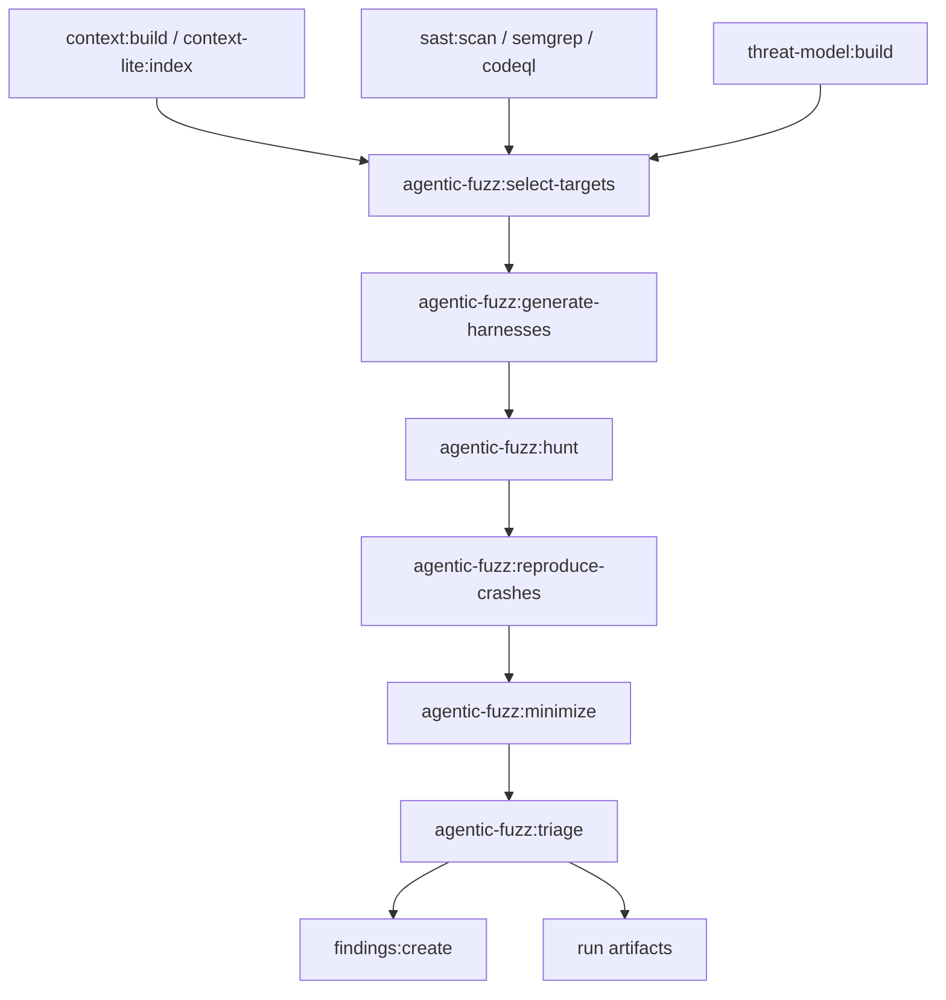
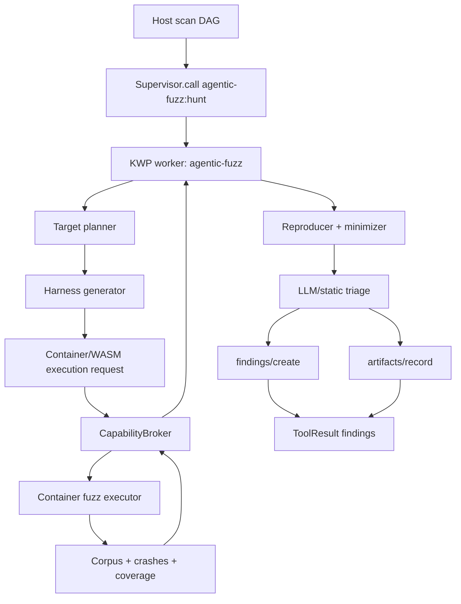
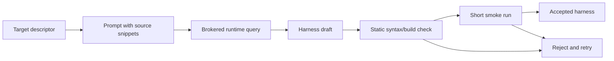

# Agentic Fuzzing as a HUNT Phase

Status: technical design for KWP-backed module implementation.

This document answers the concrete question: can a third-party or first-party agentic fuzzing module be added as a `HUNT` phase? Yes. The clean design is a `DagTool`-backed module that runs inside a KWP worker and asks the host broker for exactly the capabilities fuzzing needs: scoped filesystem, optional container execution, optional runtime triage, artifact recording, and findings creation.

The key principle is that fuzzing is not a special escape hatch. It is just another module-owned HUNT capability whose effects are host-brokered and whose outputs are host-normalized into findings, artifacts, and scan DAG outputs.

## 1. Placement in the scan pipeline



The visible HUNT tool is:

```text
agentic-fuzz:hunt
```

It participates in the DAG as a finding-producing HUNT phase. Internal helper tools may be hidden, but the host owns DAG scheduling and evaluation.

## 2. Module contract

Module id:

```text
agentic-fuzz
```

Primary tool:

```ts
defineDagTool<"agentic-fuzz", AgenticFuzzInput, AgenticFuzzOutput>({
  name: "agentic-fuzz:hunt",
  description: "Agentically generate, run, and triage fuzz harnesses for high-risk targets.",
  headless: true,
  inputSchema: agenticFuzzInputSchema,
  dag: {
    outputKind: "findings",
    dependsOn: [
      "context:build",
      "sast:scan",
      "threat-model:build"
    ]
  },
  async run(input, ctx) {
    // implemented inside KWP worker harness; all effects use ctx broker shims
  }
});
```

The `dag.condition` field MUST NOT contain executable module code in the KWP descriptor. Any gating condition is expressed as data and evaluated by host-owned policy. Example:

```json
{
  "when": {
    "any": [
      { "upstreamHasFindings": { "severityAtLeast": "medium" } },
      { "targetLanguageIn": ["rust", "c", "cpp", "go", "java", "javascript"] }
    ]
  }
}
```

## 3. Goals and non-goals

Goals:

- Add fuzzing as a modular HUNT phase without giving the module ambient filesystem, process, network, or runtime authority.
- Let the agent choose targets and harness strategies using prior scan/context outputs.
- Run fuzzing under bounded CPU, memory, time, filesystem, and network policy.
- Persist reproducible crashes, corpus, minimized inputs, coverage summaries, and generated harnesses as run artifacts.
- Convert confirmed crashes into first-class Kuzushi findings with evidence.
- Support multiple executor tiers: Node for orchestration, WASM for pure harness logic, container for native fuzz engines.

Non-goals for v0.1:

- Arbitrary local process spawning from a Node worker.
- Direct worker access to the workspace path.
- Worker-owned findings database writes.
- DAG evaluation inside the module.
- Long-lived distributed fuzzing infrastructure.

## 4. High-level runtime architecture



The module worker orchestrates. The host broker owns effects. The container executor runs fuzzing engines and returns artifact references.

## 5. Inputs

```ts
interface AgenticFuzzInput {
  target?: string;
  language?: "rust" | "c" | "cpp" | "go" | "java" | "javascript" | "python" | "auto";
  mode?: "quick" | "standard" | "deep";
  engines?: FuzzEngine[];
  maxTargets?: number;
  maxHarnessesPerTarget?: number;
  deadlineMs?: number;
  budget?: {
    runtimeUsd?: number;
    cpuSeconds?: number;
    maxArtifactsBytes?: number;
  };
  seedFindings?: string[];
  allowNetworkDuringFuzz?: boolean;
}

type FuzzEngine =
  | "cargo-fuzz"
  | "libfuzzer"
  | "aflplusplus"
  | "jazzer"
  | "go-fuzz"
  | "atheris"
  | "js-fuzzilli"
  | "property-tests";
```

Defaults:

- `mode = "quick"` in interactive shell.
- `mode = "standard"` in scan CI unless user config overrides it.
- `allowNetworkDuringFuzz = false` always defaults to false.
- `maxTargets` depends on mode.

## 6. Outputs

```ts
interface AgenticFuzzOutput {
  findings: FuzzFinding[];
  artifacts: ArtifactRef[];
  summary: {
    selectedTargets: number;
    harnessesGenerated: number;
    executions: number;
    crashes: number;
    confirmedFindings: number;
    coverage?: CoverageSummary;
    costUsd: number; // host-filled, not worker trusted
  };
}

interface FuzzFinding {
  title: string;
  severity: "low" | "medium" | "high" | "critical";
  confidence: "low" | "medium" | "high";
  target: string;
  harnessPath: string;
  crashingInputPath: string;
  minimizedInputPath?: string;
  stackTracePath?: string;
  sanitizer?: string;
  evidence: EvidenceRef[];
  reproduction: {
    command: string;
    containerImageDigest?: string;
    expectedSignal?: string;
  };
}
```

The worker may return findings in the final result, but the host only accepts them if the grant includes `findings.create`. Artifact paths are references; the host verifies and hashes them.

## 7. Capability grant

Minimal quick-mode grant:

```jsonc
{
  "fs": [
    { "scope": "input", "mode": "ro", "maxBytes": 104857600 },
    { "scope": "workspace", "mode": "rw", "maxBytes": 536870912, "maxFiles": 5000 },
    { "scope": "moduleData", "mode": "rw", "maxBytes": 1073741824, "maxFiles": 20000 }
  ],
  "net": null,
  "runtime": {
    "maxCostUsdPerInvocation": 2.0,
    "maxCostUsdPerRun": 10.0,
    "models": ["operator-default"]
  },
  "bus": {
    "produce": ["agentic-fuzz/*"],
    "consume": []
  },
  "findings": {
    "create": true,
    "maxPerInvocation": 100,
    "allowedSeverities": ["low", "medium", "high", "critical"]
  },
  "artifacts": {
    "write": true,
    "maxBytesPerInvocation": 536870912
  },
  "exec": null
}
```

Container execution is not `exec`. It is a host-owned executor tier with a constrained API. The worker requests a fuzz job; the host decides whether the module grant, target policy, and resource limits permit it.

## 8. New broker extension: fuzz execution

KWP core v0.1 deliberately keeps arbitrary `exec` out. Agentic fuzzing needs controlled execution, so it uses a higher-level extension:

```text
kuzushi/fuzz/run
```

Request:

```jsonc
{
  "invocationId": "inv_...",
  "engine": "cargo-fuzz",
  "target": {
    "language": "rust",
    "projectPath": ".",
    "harnessPath": "agentic-fuzz/harnesses/url_parse.rs"
  },
  "inputs": {
    "seedCorpusPath": "agentic-fuzz/corpus/url_parse",
    "dictionaryPath": "agentic-fuzz/dicts/url.dict"
  },
  "limits": {
    "deadlineMs": 60000,
    "cpuSeconds": 120,
    "memoryBytes": 1073741824,
    "artifactBytes": 134217728,
    "maxCrashes": 20
  },
  "sandbox": {
    "network": false,
    "readOnlySource": true
  }
}
```

Response:

```jsonc
{
  "status": "completed" | "timeout" | "crash" | "engine-error",
  "coverage": { "edges": 1234, "newEdges": 56 },
  "artifacts": [
    { "path": "agentic-fuzz/crashes/crash-001.bin", "mediaType": "application/octet-stream" },
    { "path": "agentic-fuzz/logs/run-001.txt", "mediaType": "text/plain" }
  ],
  "crashes": [
    {
      "inputPath": "agentic-fuzz/crashes/crash-001.bin",
      "stackTracePath": "agentic-fuzz/logs/crash-001.stack.txt",
      "signal": "SIGABRT",
      "dedupeKey": "sha256:..."
    }
  ]
}
```

Host-side enforcement target:

- Fuzz job runs in a host-owned executor. The current KWP slice supports
  operator-mounted command executors; production hardening should move those
  commands behind container or WASM isolation.
- Source tree is mounted read-only unless the grant explicitly allows writes.
- Worker never gets the real path of source, corpus, crash, or output dirs.
- Network is disabled inside fuzz execution by default.
- CPU, wall-clock, memory, process count, file count, and artifact byte quotas are enforced by the host.
- The host records engine version, container image digest, command line, environment, and limits in provenance.

## 9. Phases inside `agentic-fuzz:hunt`

### 9.1 Target discovery

Inputs:

- Repo context from upstream context task.
- SAST findings and hotspots.
- Threat model scenarios.
- Language/package metadata.
- Existing fuzz targets, property tests, and test fixtures.

Algorithm:

1. Read upstream DAG outputs from `ctx.dag.upstreamOutputs` or host-injected input.
2. Rank candidate functions, parsers, deserializers, protocol handlers, file format readers, boundary-crossing APIs, and prior vulnerable areas.
3. Prefer targets with deterministic entry points and cheap harnesses.
4. Emit `agentic-fuzz/target-plan.json` artifact.

Target scoring features:

- Input parser or deserializer.
- Untrusted boundary: file, HTTP, RPC, CLI arg, archive, image, binary protocol.
- Prior SAST warning nearby.
- Memory-unsafe language or unsafe block.
- Complex branching or hand-written parser.
- Existing fixtures or corpus.
- Build feasibility under available executor tier.

### 9.2 Harness generation

The worker may use `kuzushi/runtime/query` to draft a harness. The runtime response is untrusted. The module must validate and lint generated harnesses before execution.

Harness generation pipeline:



Rules:

- Generated harness code is written through `ctx.fs.write("workspace", ...)`.
- Build and smoke tests run through `kuzushi/fuzz/run` or a future container build extension, not ambient `child_process`.
- Harness code cannot access network unless the fuzz job explicitly enables it.
- Harness code and prompts are stored as artifacts for review.

### 9.3 Seed corpus and dictionaries

The worker builds seed corpora from:

- Existing tests and fixtures.
- Example inputs discovered in the repo.
- API examples from docs.
- SAST evidence snippets.
- Threat-model scenarios.
- Synthetic seeds generated by runtime calls.

All corpus files are written under:

```text
agentic-fuzz/corpus/<target-id>/
```

Dictionaries are written under:

```text
agentic-fuzz/dicts/<target-id>.dict
```

### 9.4 Fuzz execution

The worker submits one or more `kuzushi/fuzz/run` requests. The host container executor runs engines such as cargo-fuzz, libFuzzer, AFL++, Jazzer, go-fuzz, Atheris, or property-test runners.

Execution policy by mode:

| Mode | Max targets | Per-target fuzz time | Runtime use | Expected use |
|---|---:|---:|---:|---|
| `quick` | 3 | 30-90s | low | shell exploration |
| `standard` | 10 | 2-5m | moderate | normal scan HUNT |
| `deep` | 25+ | configurable | higher | manual/offline hunt |

### 9.5 Crash reproduction

Every crash is reproduced before it becomes a finding.

Process:

1. Re-run harness with crashing input.
2. Capture deterministic signal, stack, sanitizer output, and stderr.
3. Retry up to N times to classify flaky crashes.
4. Minimize crashing input when the engine supports it.
5. Dedupe crashes by stack/function/sanitizer signature.

Only reproduced crashes are promoted to findings. Non-reproducing crashes remain artifacts.

### 9.6 Triage and finding creation

The worker performs a final triage pass:

- Does the crash cross a security boundary?
- Is it memory corruption, panic/DoS, assertion failure, parser divergence, or undefined behavior?
- Is it reachable from untrusted input?
- Is there a plausible exploit or impact story?
- Is there a clear reproduction command?

The worker may ask `kuzushi/runtime/query` for summary/impact language, but the finding structure is checked host-side.

Finding fields:

```jsonc
{
  "title": "Crash in URL parser reachable from request path",
  "severity": "high",
  "confidence": "high",
  "vulnSource": "agentic-fuzz",
  "filePath": "src/url/parse.rs",
  "ruleId": "agentic-fuzz:crash",
  "message": "libFuzzer found a reproducible panic in parse_url for malformed percent encodings.",
  "evidence": [
    { "artifact": "agentic-fuzz/crashes/minimized-001.bin" },
    { "artifact": "agentic-fuzz/logs/crash-001.stack.txt" },
    { "artifact": "agentic-fuzz/harnesses/url_parse.rs" }
  ],
  "reproduction": {
    "command": "cargo fuzz run url_parse agentic-fuzz/crashes/minimized-001.bin",
    "containerImageDigest": "sha256:..."
  }
}
```

## 10. Artifact layout

All artifacts live under the invocation workspace scope:

```text
agentic-fuzz/
├── target-plan.json
├── prompts/
│   └── <target-id>.md
├── harnesses/
│   └── <target-id>.<ext>
├── corpus/
│   └── <target-id>/...
├── dicts/
│   └── <target-id>.dict
├── runs/
│   └── <target-id>/
│       ├── engine.json
│       ├── stdout.txt
│       ├── stderr.txt
│       └── coverage.json
├── crashes/
│   ├── crash-001.bin
│   └── minimized-001.bin
├── logs/
│   └── crash-001.stack.txt
└── summary.json
```

The host verifies existence, scope containment, media type, and hash for every artifact reference in the final result.

## 11. Safety controls

Agentic fuzzing is inherently effectful. The following controls are mandatory:

- No ambient `child_process` or shell access in Node worker.
- No inherited API keys or environment secrets.
- No direct workspace path exposure.
- Fuzz execution runs only in container/WASM tier.
- Network disabled by default in fuzz jobs.
- Quotas for CPU, memory, wall-clock, processes, files, and bytes.
- Host-computed runtime cost only.
- Host-stamped event origins.
- Host-verified artifact refs.
- Findings require explicit grant.
- Stale epoch results are dropped.

## 12. UX surface

CLI:

```text
kuzushi scan . --tasks agentic-fuzz:hunt --mode standard
kuzushi run agentic-fuzz:hunt --input '{"mode":"quick","language":"rust"}'
```

Shell:

```text
use agentic-fuzz
set MODE quick
run
```

Progress events:

```text
selecting fuzz targets
building harness for url_parse
running cargo-fuzz url_parse for 60s
reproducing crash crash-001
minimizing input
creating finding
```

Final summary:

```text
Agentic fuzzing completed: 7 targets, 11 harnesses, 3 crashes, 1 confirmed finding.
Artifacts: .kuzushi/runs/<runId>/agentic-fuzz/summary.json
```

## 13. Implementation plan

Current status: the repo ships a first-party one-file KWP implementation at
`examples/kwp/agentic-fuzz/module.mjs`. The committed integration test approves
that exact file digest, loads it through the dynamic `file://` worker path,
calls optional `symcc` through `kuzushi/mcp/call`, runs the host fuzz executor
through `kuzushi/fuzz/run`, records artifact refs, and verifies host-computed
hashes. The remaining work below is the production expansion from that minimum
useful slice into full scan-phase automation.

### Phase 1: inert descriptor and docs

- Keep the KWP module descriptor shape stable.
- Decide whether to surface it as a bundled default module or keep requiring
  explicit `file://` approval.
- Add DAG metadata as inert data when scan orchestration consumes the module.

### Phase 2: KWP runtime foundation

- Implement `TrustVerifier` and digest-pinned lockfile.
- Implement Node worker supervisor.
- Implement filesystem/runtime broker calls.
- Move dynamic JS module execution behind KWP.

### Phase 3: artifacts and findings

- Add artifact grant and verifier.
- Add findings grant and host-side finding creation.
- Add audit chain records for artifact and finding decisions.

### Phase 4: fuzz executor extension

- Extend the first-pass `kuzushi/fuzz/run` broker extension beyond
  operator-mounted commands.
- Implement container executor for at least one engine, preferably `cargo-fuzz` or `libFuzzer` first.
- Record engine metadata and container image digest.
- Add reproduction and minimization loop.

### Phase 5: agentic planner

- Implement target selection from context, SAST findings, and threat model.
- Add harness generation with runtime broker calls.
- Add static validation and smoke execution before fuzzing.

### Phase 6: scan integration

- Register `agentic-fuzz:hunt` as an optional HUNT phase.
- Add task selection heuristics.
- Add tests for DAG ordering, cancellation, quotas, artifact verification, and finding creation.

## 14. Test matrix

Required tests:

- Tool descriptor rejects non-`agentic-fuzz:*` names.
- Probe mode returns descriptor and rejects `tools/call`.
- Worker cannot call broker after invocation settles.
- Fuzz job denied without artifact/fuzz grant.
- Network is disabled inside fuzz job by default.
- Crashes are not findings until reproduced.
- Artifact path escape is rejected.
- Runtime cost is host-computed.
- Deadline cancels job and drops late result.
- Epoch bump invalidates in-flight result.
- Findings creation denied without grant.
- Container engine metadata is recorded in audit/provenance.

## 15. Open questions

1. Should runtime budget be global per scan run across modules or per `(module, run)`? Agentic fuzzing benefits from a global scan-level budget.
2. Should `kuzushi/fuzz/run` be KWP core or an extension namespace? Recommendation: extension namespace.
3. Which engine ships first? Recommendation: start with Rust `cargo-fuzz` or C/C++ `libFuzzer` because sanitizer evidence is strong and reproducibility is straightforward.
4. Should flaky crash artifacts become low-confidence findings or artifact-only notes? Recommendation: artifact-only until reproducible.
5. Should coverage be a first-class DAG output kind? Recommendation: keep as artifact in v0.1.

## 16. Decision

KWP enables agentic fuzzing as a HUNT phase because it gives the module enough power to orchestrate fuzzing while keeping all dangerous effects outside the worker:

- Planning and triage run in the worker.
- Files, network, runtime, artifacts, findings, and execution are brokered.
- Fuzz engines run in container/WASM tiers, not ambient Node.
- Results flow back as normal module findings and artifacts.

This makes `agentic-fuzz:hunt` a normal Kuzushi module from the operator's perspective and a strictly bounded worker from the host's perspective.
