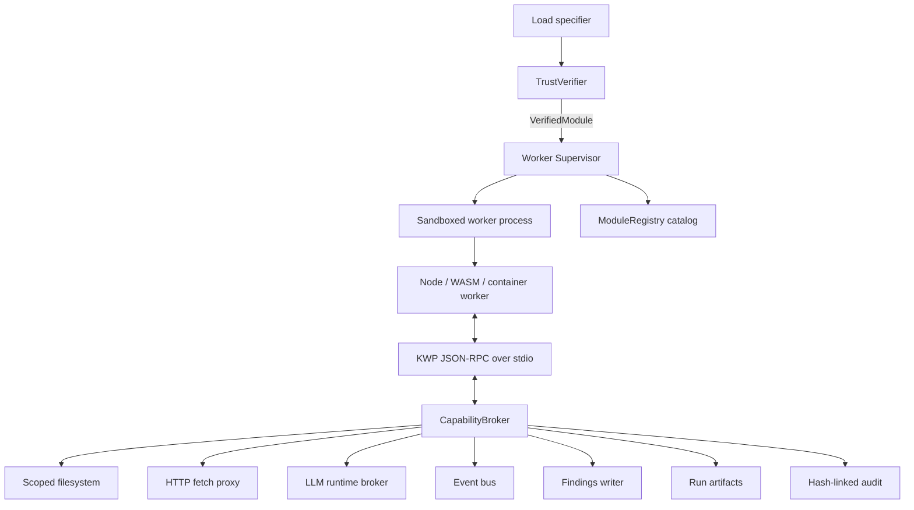
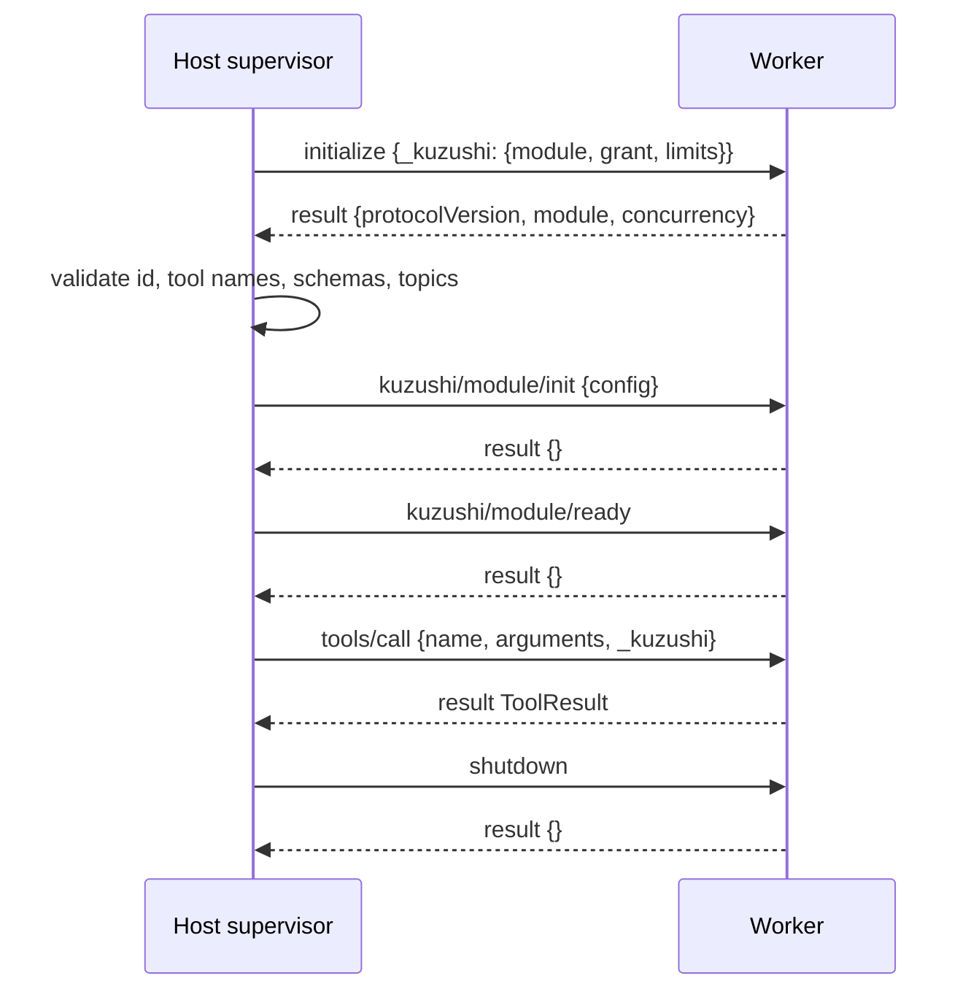

# Kuzushi Worker Protocol (KWP) v0.1

Status: partially implemented for local `file://` Node workers. The live slice
supports digest-pinned `kuzushi.lock` approvals, load-time digest and descriptor
hash verification, sanitized/permissioned descriptor probes and Node worker
spawn, JSON-RPC 2.0 over stdio, brokered filesystem/runtime/artifact/finding
calls, host-mounted stdio MCP alias calls, a host-mounted fuzz executor path,
hash-linked run audit logs, and operator
`kuzushi kwp approve|revoke|inspect|audit` commands. It
also includes a host-side HTTPS network fetch backend with allowlist checks,
named-credential validation, unsafe header stripping, DNS/IP SSRF denial,
response byte limits, and redirects disabled. The MCP path is a first-pass
stdio mount with per-call process/session isolation and descriptor-hash
checking. The fuzz path is a first-pass operator-mounted command executor with
stdin/stdout JSON, deadline kill, grant checks, network-denied-by-default
policy, and artifact verification; container/WASM fuzz isolation remains
planned hardening work.

KWP is the JSON-RPC boundary between the trusted Kuzushi host and untrusted module workers. It is the contract used by future uploaded modules, dynamic JavaScript modules, WASM shims, and container-backed scanners.

The protocol is intentionally small: process isolation is the security boundary; every privileged effect is brokered by the host; the registry is a catalog of host-checked descriptors, not a security boundary.

Normative keywords (`MUST`, `SHOULD`, `MAY`) follow RFC 2119.

## 1. Goals

1. **Process isolation is the security boundary.** The worker is untrusted. The host validates every descriptor, request, result, artifact reference, and broker call.
2. **Deny by default.** A worker with an empty grant can compute over its input and return a result. Filesystem, network, runtime, event bus, findings, and artifacts are brokered capabilities.
3. **Content-addressed trust.** Operator approval is over `(bundle digest, descriptor hash, grant)`, never over a package name alone.
4. **Every effect is attributable.** Broker calls carry an active invocation id; the host stamps module id, digest, run id, and invocation id into audit records.
5. **Cancellation is host-enforced.** Cooperative cancellation is useful, but correctness does not depend on worker cooperation. Epochs, deadlines, and broker deactivation make stale work droppable.
6. **MCP-shaped where it helps.** Transport and method names intentionally look like MCP stdio. Kuzushi-only extensions live under `kuzushi/*` methods and `_kuzushi` payload fields.

## 2. Architecture



Responsibilities:

- `TrustVerifier`: resolves a specifier, hashes the bundle, verifies signatures and lockfile approval, then returns a `VerifiedModule`.
- `Supervisor`: owns spawn, handshake, worker reuse, dispatch, deadlines, cancellation, epochs, recycle, and kill.
- `CapabilityBroker`: the only place grants are enforced, effects are metered, and audit records are emitted.
- `ModuleRegistry`: stores host-checked module and tool descriptors. It does not own trust, process lifecycle, or capability policy.

## 3. Transport

- Transport is child-process stdio.
- `stdin` and `stdout` carry newline-delimited JSON-RPC 2.0 messages.
- `stderr` is raw worker log output captured by the supervisor and tagged with `{ moduleId, digest, pid }`.
- Workers MUST NOT write non-protocol bytes to `stdout`.
- Both sides may issue JSON-RPC requests; ids MUST be unique per direction per connection.
- The host enforces `limits.maxMessageBytes` in both directions. Default: 4 MiB.
- Bulk data moves through brokered files or artifact references, not inline JSON.
- Every privileged worker-to-host request carries the host-issued
  `invocationId` and invocation `epoch`; missing, mismatched, stale, or
  post-settlement authority is rejected before the broker handler runs.

Conforming messages MUST include the JSON-RPC envelope:

```json
{"jsonrpc":"2.0","id":1,"method":"tools/call","params":{}}
```

## 4. Trust preconditions before spawn

The worker never participates in its own trust decision. Before spawning a worker, the host MUST:

1. Resolve the load specifier to an immutable bundle on disk.
2. Compute the bundle digest.
3. Locate a matching `kuzushi.lock` entry keyed by digest.
4. Verify the signature chain: author signature -> ingestion attestation -> operator approval.
   The current `file://` implementation accepts empty local-approval chains.
   Non-empty `signatureChain` entries must verify as
   `ed25519:v1:<keyId>:<base64Signature>` against keys configured in the
   operator's global config. Target-local configs cannot define signature trust
   roots.
5. Verify the normalized descriptor hash when available.
6. Load the immutable grant for the worker lifetime.

A failed trust check MUST fail closed before any module bytes are imported.

Operator commands:

```sh
kuzushi kwp approve file:///abs/path/module.mjs --grant grant.toml
kuzushi kwp inspect file:///abs/path/module.mjs
kuzushi kwp revoke sha256:<digest>
kuzushi kwp audit --json
kuzushi kwp audit --target /abs/workspace --run-id run_... --json
```

Example grant TOML:

```toml
[[fs]]
scope = "workspace"
mode = "rw"
maxBytes = 1048576

[runtime]
maxCostUsdPerInvocation = 1.0
maxCostUsdPerRun = 5.0

[artifacts]
write = true

[[mcp]]
alias = "symcc"
tools = ["compile", "run_concolic", "export_corpus"]
mode = "dedicated"
workspace = "scratch-only"

[fuzz]
engines = ["cargo-fuzz", "symcc"]
network = false
```

### 4.1 Lockfile entry

```ts
interface KuzushiLockEntry {
  moduleId: string;
  digest: `sha256:${string}`;
  version: string;
  descriptorHash: `sha256:${string}`;
  grant: Grant;
  signatureChain: SignatureChain;
  status: "approved" | "revoked";
}
```

The digest is the trust anchor. Package names, file paths, and registry names are locators only.
When present, each `signatureChain` entry signs the stable
`kuzushi-kwp-signature-v1` payload containing `moduleId`, `digest`,
`descriptorHash`, and `version`.

### 4.2 Spawn environment

The executor tier creates a child process with a scrubbed environment. It inherits no operator secrets and no ambient API keys.

```text
KWP_PROTOCOL_VERSION=0.1.0
KWP_MODULE_ROOT=/abs/path/to/verified/extracted/bundle
KWP_WORKER_MODE=serve|probe
PATH=<minimal executor-specific path>
```

`KWP_MODULE_ROOT` is read-only from the worker's perspective. OS sandboxing (Landlock/seccomp on Linux, sandbox-exec or equivalent on macOS, job objects on Windows, and container isolation for container tier) is applied by the executor and is outside the wire protocol.

## 5. Lifecycle

The live `file://` Node path currently implements the minimal serving subset:
`initialize`, host descriptor-hash validation, `tools/call`, epoch-authorized
broker calls, deadline kill, and process teardown after the invocation. Deadline settlement sends
`notifications/cancelled { invocationId, reason: "deadline" }`, exposes
`ctx.signal` to Node module code, records `invocation.cancel`, and drops any
worker result that arrives after the host deadline. The one-shot worker path
uses epoch `1` and validates that epoch on every broker request; reusable-worker
epoch bumping and recycling remain the next supervisor hardening slice. The
`kuzushi/module/init`, `kuzushi/module/ready`, and explicit `shutdown` hooks
below are the protocol contract for that slice;
correctness today does not depend on worker cooperation because the host kills
the one-shot worker after settlement or deadline.



### 5.1 `initialize`

Host request params:

```jsonc
{
  "protocolVersion": "0.1.0",
  "hostInfo": { "name": "kuzushi", "version": "..." },
  "_kuzushi": {
    "module": {
      "id": "my-module",
      "digest": "sha256:...",
      "entry": "dist/index.js"
    },
    "grant": { "...": "see section 9" },
    "limits": {
      "maxConcurrentInvocations": 1,
      "defaultDeadlineMs": 120000,
      "maxMessageBytes": 4194304
    }
  }
}
```

Worker result:

```jsonc
{
  "protocolVersion": "0.1.0",
  "module": {
    "id": "my-module",
    "displayName": "My Module",
    "version": "1.4.2",
    "category": "defense",
    "description": "...",
    "tools": [
      {
        "name": "my-module:scan",
        "description": "Scan target input.",
        "inputSchema": { "type": "object", "properties": {}, "additionalProperties": false },
        "headless": true,
        "hidden": false,
        "rank": "normal",
        "dag": null
      }
    ],
    "events": { "produces": ["my-module/finding"], "consumes": [] }
  },
  "concurrency": 1
}
```

Host validation after `initialize` is fatal on failure:

- `module.id` MUST match the verified module id.
- Tool names MUST match `^<module.id>:[a-z0-9][a-z0-9-]*$`.
- Tool names MUST be unique within the module.
- Every `inputSchema` MUST compile under the host's JSON Schema dialect.
- Missing `additionalProperties` on top-level object schemas is treated as `false` by the host.
- Declared bus topics MUST be subsets of the immutable grant.
- DAG metadata is inert data; the host MUST NOT execute module-provided predicates or functions.

### 5.2 Probe mode

`KWP_WORKER_MODE=probe` is used by ingestion. Probe mode uses the same worker entrypoint and `initialize` path as serving mode, but with an all-deny grant.

In probe mode:

- `initialize` MUST return the descriptor.
- `tools/call` MUST return JSON-RPC `-32601`.
- The host sends `shutdown` immediately after descriptor extraction.

### 5.3 Module lifecycle hooks

`CopilotModule.init?/ready?/dispose?` map to protocol methods:

- `kuzushi/module/init` receives host-checked config.
- `kuzushi/module/ready` fires after the host is ready to route invocations.
- `shutdown` calls `dispose?()`, flushes logs, replies, and exits 0.

Broker access during init is deny-by-default. v0.1 permits filesystem reads only if covered by the grant and `initCapabilities` allows them. Net, runtime, bus, findings, and artifact writes during init are denied unless a future grant extension explicitly permits them.

## 6. Tool invocation

### 6.1 `tools/call`

Host request params:

```jsonc
{
  "name": "my-module:scan",
  "arguments": { "target": "input.bin" },
  "_kuzushi": {
    "invocationId": "inv_01J...",
    "runId": "run_01J...",
    "epoch": 42,
    "deadlineMs": 120000,
    "workspace": { "root": "ws://" }
  }
}
```

Rules:

- The host validates `arguments` against the tool's input schema before sending.
- The worker MAY re-validate, but MUST NOT rely on receiving invalid data.
- `workspace.root` is opaque. The worker never receives a real workspace path.
- All brokered filesystem paths are scope-relative.

### 6.2 Result

Worker result:

```jsonc
{
  "ok": true,
  "output": "human-readable summary",
  "data": { "count": 3 },
  "artifacts": [
    { "path": "findings/scan.sarif", "mediaType": "application/sarif+json" }
  ],
  "findings": []
}
```

Failure result:

```jsonc
{
  "ok": false,
  "output": "",
  "error": {
    "kind": "retryable",
    "message": "temporary engine failure",
    "detail": {}
  }
}
```

Host post-processing:

- Verify every artifact reference exists and resolves within the invocation's granted workspace scope.
- Hash every artifact into the run provenance record.
- Ignore worker-reported `costUsd`; host-computed runtime spend is authoritative.
- Drop stale epoch results.
- Normalize into the host `ToolResult` consumed by shell, run mode, and scan DAG.

Findings are privileged output. A worker may include `findings` only when the grant contains `findings.create`. Otherwise the host converts the result to a denied failure or drops the findings with an audit denial, depending on caller policy.

## 7. Broker calls

Every privileged worker->host operation is a JSON-RPC request. Every broker request MUST carry an active `invocationId`. The broker rejects calls with no active invocation using `-32030`.

This rule closes the background-scavenging channel: after a tool settles, any lingering async task in the worker loses broker access.

### 7.1 Filesystem

Granted scopes:

- `workspace`: per-run working area and module-visible artifacts.
- `moduleData`: per-module durable cache.
- `input`: host-provided read-only inputs.

Methods:

```text
kuzushi/fs/read    { invocationId, scope, path, offset?, length? }
kuzushi/fs/write   { invocationId, scope, path, data, append? }
kuzushi/fs/list    { invocationId, scope, path }
kuzushi/fs/stat    { invocationId, scope, path }
kuzushi/fs/remove  { invocationId, scope, path }
```

Paths are forward-slash, scope-relative paths. Absolute paths, empty segments,
and `..` segments are schema-rejected. The host also resolves through scope
roots and rejects symlink/canonicalization escapes before every filesystem
operation. `maxBytes` and `maxFiles` grants are enforced per invocation across
brokered reads and writes; an over-budget write is denied before the host
touches the filesystem. `remove` requires `rw`, denies symlink candidates, and
removes files or empty directories only.

### 7.2 Network

```text
kuzushi/net/fetch {
  invocationId,
  method,
  url,
  headers?,
  bodyBase64?,
  timeoutMs?,
  credentialName?,
  responseArtifactPath?,
  responseMediaType?
}
```

Rules:

- HTTPS only in v0.1.
- URL host/port must match `grant.net.allow`.
- Redirects are not followed in the first backend; the worker receives the
  redirect response and must make a new brokered request if policy allows it.
- Private, loopback, link-local, multicast, and metadata-service addresses are denied.
- DNS resolution is broker-owned.
- Worker-supplied `authorization`, `cookie`, `proxy-*`, and `x-forwarded-*` headers are stripped unless a future grant explicitly permits them.
- Named credentials are attached host-side and never exposed to the worker.
- `maxBytesPerInvocation` is cumulative across brokered request bodies and
  response bodies. The live backend rejects over-limit `Content-Length` before
  reading and caps unknown-length reads to the remaining invocation budget.
- Responses are returned as `bodyBase64` when they fit the remaining grant byte
  budget.
  If the request includes `responseArtifactPath`, the host writes the response
  body under the active artifact root, requires `artifacts.write`, enforces the
  artifact byte quota, verifies the path and hash, returns an `artifact` ref,
  and omits the inline body.

### 7.3 Runtime

```text
kuzushi/runtime/query { invocationId, messages, systemPrompt?, maxTokens, modelPreferences? }
```

Rules:

- The host owns credentials.
- The host prepends a provenance preamble identifying module id, digest, and invocation id.
- The host meters cost per invocation and per run.
- Runtime completions are returned verbatim as untrusted data. The host does not interpret them.

### 7.4 Event bus

```text
kuzushi/bus/publish { invocationId, topic, payload }
```

Rules:

- Topic must match `grant.bus.produce`.
- Host stamps `origin = { moduleId, digest, invocationId }`.
- Workers cannot forge origins.
- Workspace-backed runs append allowed publishes to
  `.kuzushi/v3/runs/<runId>/kwp-bus.jsonl`.
- Subscriptions are declared during `initialize`; the host delivers `kuzushi/bus/event` notifications for granted consume topics.

### 7.5 Findings and artifacts

v0.1 treats findings and artifacts as first-class privileged channels:

```text
kuzushi/findings/create { invocationId, findings[] }
kuzushi/artifacts/record { invocationId, artifacts[] }
```

The live `file://` Node worker path persists findings through `FindingStore`
when the caller supplies a findings store, creates the run lifecycle row before
insertion, enforces `findings.create`, `maxPerInvocation`, and
`allowedSeverities`, and stamps the active tool name/run as host-side
provenance. If no store is available, the broker returns
`findings.unavailable` instead of pretending to create records.

Artifact refs are arrays of `{ path, mediaType, sha256? }`. The host enforces
`artifacts.write`, rejects path escapes, requires the referenced file to exist
under the active workspace/module-data root, enforces the artifact byte quota,
and fills or verifies the `sha256:` digest. The host may also accept
`findings` and `artifacts` in the final result; those values are untrusted
until they pass the same broker checks.

The live stdio worker supervisor enforces
`runtime.worker_watchdog_timeout_ms` around the full invocation. After the
deadline expires the host records `invocation.cancel`, sends
`notifications/cancelled` as a best-effort cooperative signal, returns
`deadline exceeded`, kills the child process, and drops late worker output or
broker requests. Worker-reported results received after the deadline are stale
and are not normalized into a successful `ToolResult`.

### 7.6 MCP aliases

KWP workers call mounted MCP servers only through:

```text
kuzushi/mcp/call { invocationId, alias, tool, arguments, limits? }
```

The live `file://` Node worker path builds a host catalog from
`operator.mcp_mounts`, checks the module grant for `alias + tool`, verifies the
mounted server's `tools/list` descriptor hash before `tools/call`, and returns
only normalized `{ structuredContent, artifacts }` results. Returned artifact
refs are resolved under the active workspace/module-data root, size-checked,
and hashed before being passed back to the worker.

Current stdio mounts spawn one MCP process per call and pass a host-derived
`KUZUSHI_MCP_SESSION_ID` to the server. That gives useful session isolation
now; long-lived shared pools, container-backed mounts, descriptor approval UX,
per-MCP-call deadlines beyond the invocation watchdog, and richer audit details
remain follow-up work.

Example operator config:

```toml
[[operator.mcp_mounts]]
alias = "symcc"
command = ["kuzushi-mcp-symcc"]
descriptor_hash = "sha256:..."

[[operator.mcp_mounts.tools]]
name = "compile"
description = "Compile a harness with SymCC instrumentation"
input_schema = { type = "object" }
output_schema = { type = "object" }
```

### 7.7 Fuzz execution

KWP workers request fuzz jobs only through:

```text
kuzushi/fuzz/run { invocationId, engine, target, inputs?, limits?, sandbox? }
```

The live `file://` Node worker path checks the module's `fuzz` grant, requires
an explicit `artifacts.write` grant, rejects path escapes in `projectPath`,
`harnessPath`, and path-like inputs, enforces per-invocation job/resource
limits, and denies `sandbox.network = true` unless the grant allows networked
fuzzing. Returned artifact refs are resolved, byte-limited, and hashed before
the worker sees them.

Current fuzz executors are operator-mounted commands configured under
`operator.fuzz_executors`. The host passes a JSON job envelope on stdin and
expects a `FuzzRunResult` JSON object on stdout. Worker processes never receive
an exec primitive or the operator's environment.

Example operator config:

```toml
[[operator.fuzz_executors]]
engine = "property-tests"
command = ["kuzushi-fuzz-property-runner"]
timeout_ms = 60000
```

This first-pass command backend is intended as the adapter seam for container or
WASM runners. Operators should mount commands that enforce the requested
sandbox, especially network denial; full container/WASM enforcement remains
planned.

## 8. Cancellation, epochs, deadlines

- `notifications/cancelled` is sent from host to worker with `{ invocationId, reason }`.
- On cancel, the host deactivates the invocation immediately before waiting for worker cooperation and records `invocation.cancel`.
- The Node worker host wires cancellation into `ctx.signal` / `AbortSignal`.
- If the worker does not settle within `cancelGraceMs`, the supervisor recycles the process.
- The host bumps worker epoch on cancel-all, run restart, grant reload, or recycle.
- Broker calls and final results check epoch. Stale results are dropped or mapped to fatal stale-result errors.
- Deadlines are host-enforced. On expiry the host synthesizes a timeout result upstream and stops brokering.

## 9. Grant descriptor

```ts
interface Grant {
  fs: Array<{
    scope: "workspace" | "moduleData" | "input";
    mode: "ro" | "rw";
    maxBytes?: number;
    maxFiles?: number;
  }>;

  net: null | {
    allow: string[];
    credentials?: string[];
    maxRequestsPerInvocation?: number;
    maxBytesPerInvocation?: number;
  };

  runtime: null | {
    maxCostUsdPerInvocation: number;
    maxCostUsdPerRun: number;
    models?: string[];
  };

  bus: {
    produce: string[];
    consume: string[];
  };

  findings: null | {
    create: boolean;
    maxPerInvocation?: number;
    allowedSeverities?: string[];
  };

  artifacts: null | {
    write: boolean;
    maxBytesPerInvocation?: number;
  };

  exec: null;
  initCapabilities?: "fsRead";
}
```

`exec` is intentionally `null` in KWP core v0.1. Modules that need arbitrary binaries should use the container executor tier so process, filesystem, and network isolation remain explicit.

## 10. Error codes

JSON-RPC standard codes apply. Kuzushi reserves:

| Code | Meaning | Tool error kind |
|---|---|---|
| `-32030` | No active invocation / bad invocation id | denied |
| `-32031` | Capability not granted | denied |
| `-32032` | Quota exceeded | denied |
| `-32033` | Runtime budget exceeded | denied |
| `-32034` | Epoch stale | dropped |
| `-32035` | Deadline exceeded | timeout |
| `-32036` | Module fault, retryable | retryable |
| `-32037` | Module fault, fatal | fatal |

`denied` is routing-significant: the supervisor does not retry it, and repeated denials against the same capability should raise a policy alert.

## 11. Audit records

The host writes one append-only audit record per broker decision and invocation lifecycle event:

```jsonc
{
  "tsMs": 1783380000000,
  "runId": "run_...",
  "invocationId": "inv_...",
  "moduleId": "my-module",
  "digest": "sha256:...",
  "event": "runtime.query",
  "decision": "allow",
  "detail": { "tokens": 1234, "costUsd": 0.0123 },
  "prev": "sha256:...",
  "hash": "sha256:..."
}
```

Workspace-backed `file://` worker runs persist these records at
`.kuzushi/v3/runs/<runId>/kwp-audit.jsonl`. The `prev` and `hash` fields
hash-link records within a run. This gives the run a tamper-evident provenance
chain from `invocation.start` to `invocation.end`. Operators can inspect the
records alongside the lockfile audit summary; the command recomputes each
record hash and reports chain integrity. The same command also includes
run-local bus publishes from `.kuzushi/v3/runs/<runId>/kwp-bus.jsonl` under
`runAudit.bus`:

```sh
kuzushi kwp audit --target /abs/workspace --run-id run_... --json
```

## 12. Implementation phases

1. Add digest-pinned `kuzushi.lock` and `TrustVerifier`.
2. Add `Supervisor` and KWP stdio transport for Node workers. The current
   `file://` path implements one-shot spawn, `initialize`, `tools/call`,
   deadline kill, stderr tagging, and protocol-only stdout redirection.
3. Move dynamic JS execution behind out-of-process workers without changing
   author-facing APIs. Implemented for approved local `file://` modules;
   descriptor probes and serve workers use stripped environments plus Node
   file-read permissions.
4. Add `CapabilityBroker` for filesystem and runtime. Implemented for the live
   Node worker path with invocation-id plus epoch checks, host-computed runtime
   cost, and hash-linked broker audit records for workspace-backed runs.
5. Add network broker with SSRF hardening and named credentials. Initial HTTPS
   backend is implemented with redirects disabled and grant-gated response
   artifact spilling.
6. Add event bus, findings, and artifact grants. Findings persistence,
   host-verified artifact refs, and run-local durable bus publishes are
   implemented for `file://` Node workers.
7. Add WASM executor tier.
8. Add container executor tier.
9. Add MCP adapter layer. Initial stdio mounted aliases are implemented for
   `file://` Node workers; pooled/container supervision and descriptor
   approval UX remain planned.
10. Add fuzz executor layer. Initial operator-mounted command executors are
    implemented for `file://` Node workers; container/WASM isolation,
    reproduction/minimization, and engine metadata remain planned.

## 13. Non-negotiable invariants

- No bytes execute before digest verification.
- Trust is by digest, not package name.
- Grants are immutable for a worker lifetime.
- No inherited environment secrets.
- Worker stdout is protocol only.
- Every privileged call requires an active invocation id and current epoch.
- Broker access stops immediately after result, cancel, deadline, or epoch bump.
- Runtime cost is host-computed.
- Artifacts are by reference and host-verified.
- Findings require explicit `findings.create` grant.
- Bus origin is host-stamped.
- DAG evaluation remains host-owned.
- `exec` is not in KWP core v0.1.
