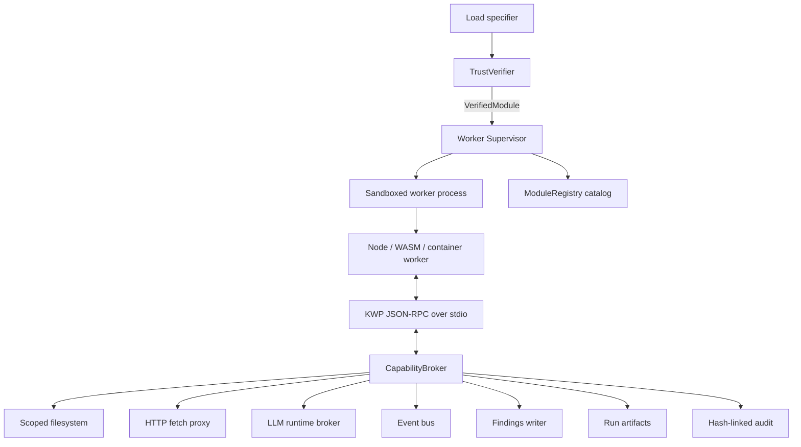
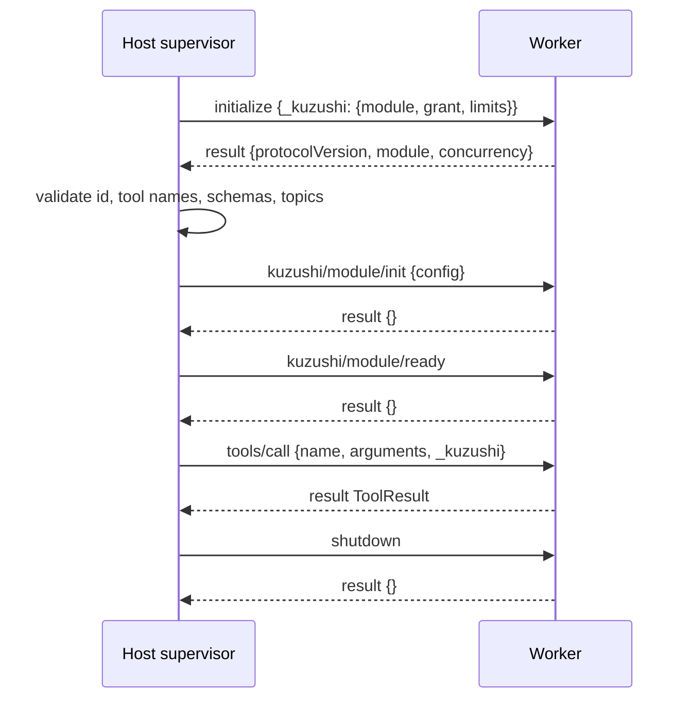

# Kuzushi Worker Protocol (KWP) v0.1

Status: draft for implementation review.

KWP is the JSON-RPC boundary between the trusted Kuzushi host and untrusted module workers. It is the contract used by future uploaded modules, dynamic JavaScript modules, WASM shims, and container-backed scanners.

The protocol is intentionally small: process isolation is the security boundary; every privileged effect is brokered by the host; the registry is a catalog of host-checked descriptors, not a security boundary.

Normative keywords (`MUST`, `SHOULD`, `MAY`) follow RFC 2119.

## 1. Goals

1. **Process isolation is the security boundary.** The worker is untrusted. The host validates every descriptor, request, result, artifact reference, and broker call.
2. **Deny by default.** A worker with an empty grant can compute over its input and return a result. Filesystem, network, runtime, event bus, findings, and artifacts are brokered capabilities.
3. **Content-addressed trust.** Operator approval is over `(bundle digest, descriptor hash, grant)`, never over a package name alone.
4. **Every effect is attributable.** Broker calls carry an active invocation id; the host stamps module id, digest, run id, and invocation id into audit records.
5. **Cancellation is host-enforced.** Cooperative cancellation is useful, but correctness does not depend on worker cooperation. Epochs, deadlines, and broker deactivation make stale work droppable.
6. **MCP-shaped where it helps.** Transport and method names intentionally look like MCP stdio. Kuzushi-only extensions live under `kuzushi/*` methods and `_kuzushi` payload fields.

## 2. Architecture



Responsibilities:

- `TrustVerifier`: resolves a specifier, hashes the bundle, verifies signatures and lockfile approval, then returns a `VerifiedModule`.
- `Supervisor`: owns spawn, handshake, worker reuse, dispatch, deadlines, cancellation, epochs, recycle, and kill.
- `CapabilityBroker`: the only place grants are enforced, effects are metered, and audit records are emitted.
- `ModuleRegistry`: stores host-checked module and tool descriptors. It does not own trust, process lifecycle, or capability policy.

## 3. Transport

- Transport is child-process stdio.
- `stdin` and `stdout` carry newline-delimited JSON-RPC 2.0 messages.
- `stderr` is raw worker log output captured by the supervisor and tagged with `{ moduleId, digest, pid }`.
- Workers MUST NOT write non-protocol bytes to `stdout`.
- Both sides may issue JSON-RPC requests; ids MUST be unique per direction per connection.
- The host enforces `limits.maxMessageBytes` in both directions. Default: 4 MiB.
- Bulk data moves through brokered files or artifact references, not inline JSON.

Conforming messages MUST include the JSON-RPC envelope:

```json
{"jsonrpc":"2.0","id":1,"method":"tools/call","params":{}}
```

## 4. Trust preconditions before spawn

The worker never participates in its own trust decision. Before spawning a worker, the host MUST:

1. Resolve the load specifier to an immutable bundle on disk.
2. Compute the bundle digest.
3. Locate a matching `kuzushi.lock` entry keyed by digest.
4. Verify the signature chain: author signature -> ingestion attestation -> operator approval.
5. Verify the normalized descriptor hash when available.
6. Load the immutable grant for the worker lifetime.

A failed trust check MUST fail closed before any module bytes are imported.

### 4.1 Lockfile entry

```ts
interface KuzushiLockEntry {
  moduleId: string;
  digest: `sha256:${string}`;
  version: string;
  descriptorHash: `sha256:${string}`;
  grant: Grant;
  signatureChain: SignatureChain;
  status: "approved" | "revoked";
}
```

The digest is the trust anchor. Package names, file paths, and registry names are locators only.

### 4.2 Spawn environment

The executor tier creates a child process with a scrubbed environment. It inherits no operator secrets and no ambient API keys.

```text
KWP_PROTOCOL_VERSION=0.1.0
KWP_MODULE_ROOT=/abs/path/to/verified/extracted/bundle
KWP_WORKER_MODE=serve|probe
PATH=<minimal executor-specific path>
```

`KWP_MODULE_ROOT` is read-only from the worker's perspective. OS sandboxing (Landlock/seccomp on Linux, sandbox-exec or equivalent on macOS, job objects on Windows, and container isolation for container tier) is applied by the executor and is outside the wire protocol.

## 5. Lifecycle



### 5.1 `initialize`

Host request params:

```jsonc
{
  "protocolVersion": "0.1.0",
  "hostInfo": { "name": "kuzushi", "version": "..." },
  "_kuzushi": {
    "module": {
      "id": "my-module",
      "digest": "sha256:...",
      "entry": "dist/index.js"
    },
    "grant": { "...": "see section 9" },
    "limits": {
      "maxConcurrentInvocations": 1,
      "defaultDeadlineMs": 120000,
      "maxMessageBytes": 4194304
    }
  }
}
```

Worker result:

```jsonc
{
  "protocolVersion": "0.1.0",
  "module": {
    "id": "my-module",
    "displayName": "My Module",
    "version": "1.4.2",
    "category": "defense",
    "description": "...",
    "tools": [
      {
        "name": "my-module:scan",
        "description": "Scan target input.",
        "inputSchema": { "type": "object", "properties": {}, "additionalProperties": false },
        "headless": true,
        "hidden": false,
        "rank": "normal",
        "dag": null
      }
    ],
    "events": { "produces": ["my-module/finding"], "consumes": [] }
  },
  "concurrency": 1
}
```

Host validation after `initialize` is fatal on failure:

- `module.id` MUST match the verified module id.
- Tool names MUST match `^<module.id>:[a-z0-9][a-z0-9-]*$`.
- Tool names MUST be unique within the module.
- Every `inputSchema` MUST compile under the host's JSON Schema dialect.
- Missing `additionalProperties` on top-level object schemas is treated as `false` by the host.
- Declared bus topics MUST be subsets of the immutable grant.
- DAG metadata is inert data; the host MUST NOT execute module-provided predicates or functions.

### 5.2 Probe mode

`KWP_WORKER_MODE=probe` is used by ingestion. Probe mode uses the same worker entrypoint and `initialize` path as serving mode, but with an all-deny grant.

In probe mode:

- `initialize` MUST return the descriptor.
- `tools/call` MUST return JSON-RPC `-32601`.
- The host sends `shutdown` immediately after descriptor extraction.

### 5.3 Module lifecycle hooks

`CopilotModule.init?/ready?/dispose?` map to protocol methods:

- `kuzushi/module/init` receives host-checked config.
- `kuzushi/module/ready` fires after the host is ready to route invocations.
- `shutdown` calls `dispose?()`, flushes logs, replies, and exits 0.

Broker access during init is deny-by-default. v0.1 permits filesystem reads only if covered by the grant and `initCapabilities` allows them. Net, runtime, bus, findings, and artifact writes during init are denied unless a future grant extension explicitly permits them.

## 6. Tool invocation

### 6.1 `tools/call`

Host request params:

```jsonc
{
  "name": "my-module:scan",
  "arguments": { "target": "input.bin" },
  "_kuzushi": {
    "invocationId": "inv_01J...",
    "runId": "run_01J...",
    "epoch": 42,
    "deadlineMs": 120000,
    "workspace": { "root": "ws://" }
  }
}
```

Rules:

- The host validates `arguments` against the tool's input schema before sending.
- The worker MAY re-validate, but MUST NOT rely on receiving invalid data.
- `workspace.root` is opaque. The worker never receives a real workspace path.
- All brokered filesystem paths are scope-relative.

### 6.2 Result

Worker result:

```jsonc
{
  "ok": true,
  "output": "human-readable summary",
  "data": { "count": 3 },
  "artifacts": [
    { "path": "findings/scan.sarif", "mediaType": "application/sarif+json" }
  ],
  "findings": []
}
```

Failure result:

```jsonc
{
  "ok": false,
  "output": "",
  "error": {
    "kind": "retryable",
    "message": "temporary engine failure",
    "detail": {}
  }
}
```

Host post-processing:

- Verify every artifact reference exists and resolves within the invocation's granted workspace scope.
- Hash every artifact into the run provenance record.
- Ignore worker-reported `costUsd`; host-computed runtime spend is authoritative.
- Drop stale epoch results.
- Normalize into the host `ToolResult` consumed by shell, run mode, and scan DAG.

Findings are privileged output. A worker may include `findings` only when the grant contains `findings.create`. Otherwise the host converts the result to a denied failure or drops the findings with an audit denial, depending on caller policy.

## 7. Broker calls

Every privileged worker->host operation is a JSON-RPC request. Every broker request MUST carry an active `invocationId`. The broker rejects calls with no active invocation using `-32030`.

This rule closes the background-scavenging channel: after a tool settles, any lingering async task in the worker loses broker access.

### 7.1 Filesystem

Granted scopes:

- `workspace`: per-run working area and module-visible artifacts.
- `moduleData`: per-module durable cache.
- `input`: host-provided read-only inputs.

Methods:

```text
kuzushi/fs/read    { invocationId, scope, path, offset?, length? }
kuzushi/fs/write   { invocationId, scope, path, data, append? }
kuzushi/fs/list    { invocationId, scope, path }
kuzushi/fs/stat    { invocationId, scope, path }
kuzushi/fs/remove  { invocationId, scope, path }
```

Paths are forward-slash, scope-relative paths. Absolute paths, empty segments, and `..` segments are schema-rejected. The host also resolves through scope roots and rejects symlink/canonicalization escapes before every filesystem operation.

### 7.2 Network

```text
kuzushi/net/fetch { invocationId, method, url, headers?, body?, timeoutMs? }
```

Rules:

- HTTP(S) only in v0.1.
- URL host/port must match `grant.net.allow`.
- Redirects are re-checked per hop.
- Private, loopback, link-local, multicast, and metadata-service addresses are denied.
- DNS resolution is broker-owned.
- Worker-supplied `authorization`, `cookie`, `proxy-*`, and `x-forwarded-*` headers are stripped unless a future grant explicitly permits them.
- Named credentials are attached host-side and never exposed to the worker.
- Large responses spill to a workspace artifact and return an artifact reference.

### 7.3 Runtime

```text
kuzushi/runtime/query { invocationId, messages, systemPrompt?, maxTokens, modelPreferences? }
```

Rules:

- The host owns credentials.
- The host prepends a provenance preamble identifying module id, digest, and invocation id.
- The host meters cost per invocation and per run.
- Runtime completions are returned verbatim as untrusted data. The host does not interpret them.

### 7.4 Event bus

```text
kuzushi/bus/publish { invocationId, topic, payload }
```

Rules:

- Topic must match `grant.bus.produce`.
- Host stamps `origin = { moduleId, digest, invocationId }`.
- Workers cannot forge origins.
- Subscriptions are declared during `initialize`; the host delivers `kuzushi/bus/event` notifications for granted consume topics.

### 7.5 Findings and artifacts

v0.1 treats findings and artifacts as first-class privileged channels:

```text
kuzushi/findings/create { invocationId, findings }
kuzushi/artifacts/record { invocationId, path, mediaType }
```

The host may also accept `findings` and `artifacts` in the final result. In either form, grants are enforced, paths are verified, and provenance is recorded host-side.

## 8. Cancellation, epochs, deadlines

- `notifications/cancelled` is sent from host to worker with `{ invocationId, reason }`.
- On cancel, the host deactivates the invocation immediately before waiting for worker cooperation.
- The worker SHOULD wire cancellation into `AbortSignal`.
- If the worker does not settle within `cancelGraceMs`, the supervisor recycles the process.
- The host bumps worker epoch on cancel-all, run restart, grant reload, or recycle.
- Broker calls and final results check epoch. Stale results are dropped or mapped to fatal stale-result errors.
- Deadlines are host-enforced. On expiry the host synthesizes a timeout result upstream and stops brokering.

## 9. Grant descriptor

```ts
interface Grant {
  fs: Array<{
    scope: "workspace" | "moduleData" | "input";
    mode: "ro" | "rw";
    maxBytes?: number;
    maxFiles?: number;
  }>;

  net: null | {
    allow: string[];
    credentials?: string[];
    maxRequestsPerInvocation?: number;
    maxBytesPerInvocation?: number;
  };

  runtime: null | {
    maxCostUsdPerInvocation: number;
    maxCostUsdPerRun: number;
    models?: string[];
  };

  bus: {
    produce: string[];
    consume: string[];
  };

  findings: null | {
    create: boolean;
    maxPerInvocation?: number;
    allowedSeverities?: string[];
  };

  artifacts: null | {
    write: boolean;
    maxBytesPerInvocation?: number;
  };

  exec: null;
  initCapabilities?: "fsRead";
}
```

`exec` is intentionally `null` in KWP core v0.1. Modules that need arbitrary binaries should use the container executor tier so process, filesystem, and network isolation remain explicit.

## 10. Error codes

JSON-RPC standard codes apply. Kuzushi reserves:

| Code | Meaning | Tool error kind |
|---|---|---|
| `-32030` | No active invocation / bad invocation id | denied |
| `-32031` | Capability not granted | denied |
| `-32032` | Quota exceeded | denied |
| `-32033` | Runtime budget exceeded | denied |
| `-32034` | Epoch stale | dropped |
| `-32035` | Deadline exceeded | timeout |
| `-32036` | Module fault, retryable | retryable |
| `-32037` | Module fault, fatal | fatal |

`denied` is routing-significant: the supervisor does not retry it, and repeated denials against the same capability should raise a policy alert.

## 11. Audit records

The host writes one append-only audit record per broker decision and invocation lifecycle event:

```jsonc
{
  "ts": "...",
  "runId": "run_...",
  "invocationId": "inv_...",
  "moduleId": "my-module",
  "digest": "sha256:...",
  "event": "runtime.query",
  "decision": "allow",
  "detail": { "tokens": 1234, "costUsd": 0.0123 },
  "prev": "sha256:..."
}
```

The `prev` field hash-links records within a run. This gives the run a tamper-evident provenance chain from `invocation.start` to `invocation.end`.

## 12. Implementation phases

1. Add digest-pinned `kuzushi.lock` and `TrustVerifier`.
2. Add `Supervisor` and KWP stdio transport for Node workers.
3. Move dynamic JS execution behind out-of-process workers without changing author-facing APIs.
4. Add `CapabilityBroker` for filesystem and runtime.
5. Add network broker with SSRF hardening and named credentials.
6. Add event bus, findings, and artifact grants.
7. Add WASM executor tier.
8. Add container executor tier.
9. Add MCP adapter layer.

## 13. Non-negotiable invariants

- No bytes execute before digest verification.
- Trust is by digest, not package name.
- Grants are immutable for a worker lifetime.
- No inherited environment secrets.
- Worker stdout is protocol only.
- Every privileged call requires an active invocation.
- Broker access stops immediately after result, cancel, deadline, or epoch bump.
- Runtime cost is host-computed.
- Artifacts are by reference and host-verified.
- Findings require explicit `findings.create` grant.
- Bus origin is host-stamped.
- DAG evaluation remains host-owned.
- `exec` is not in KWP core v0.1.
