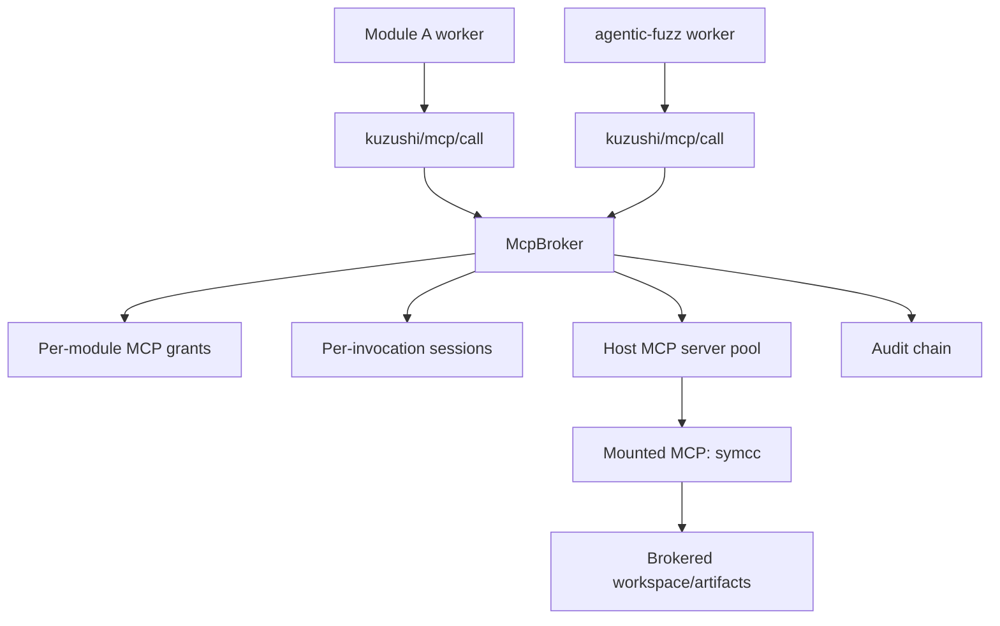
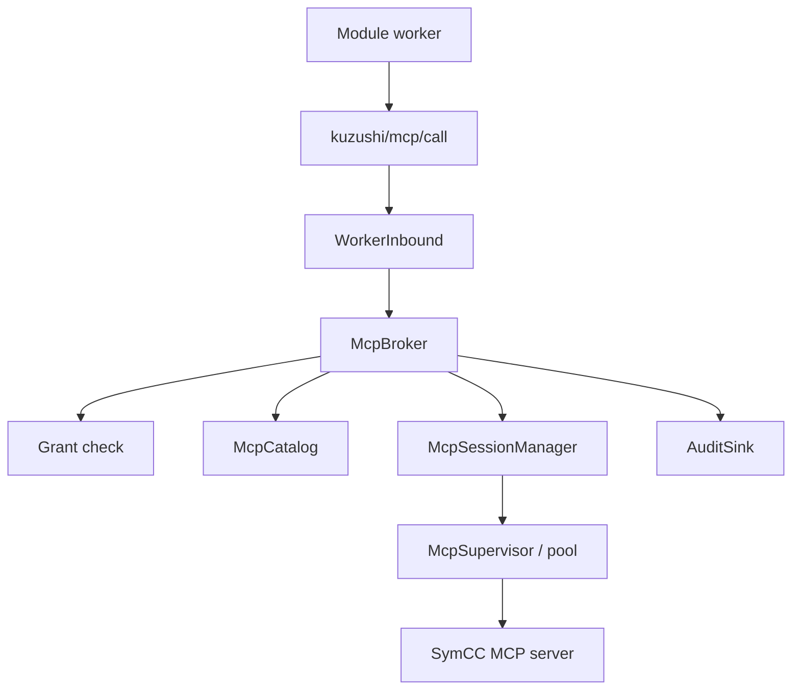
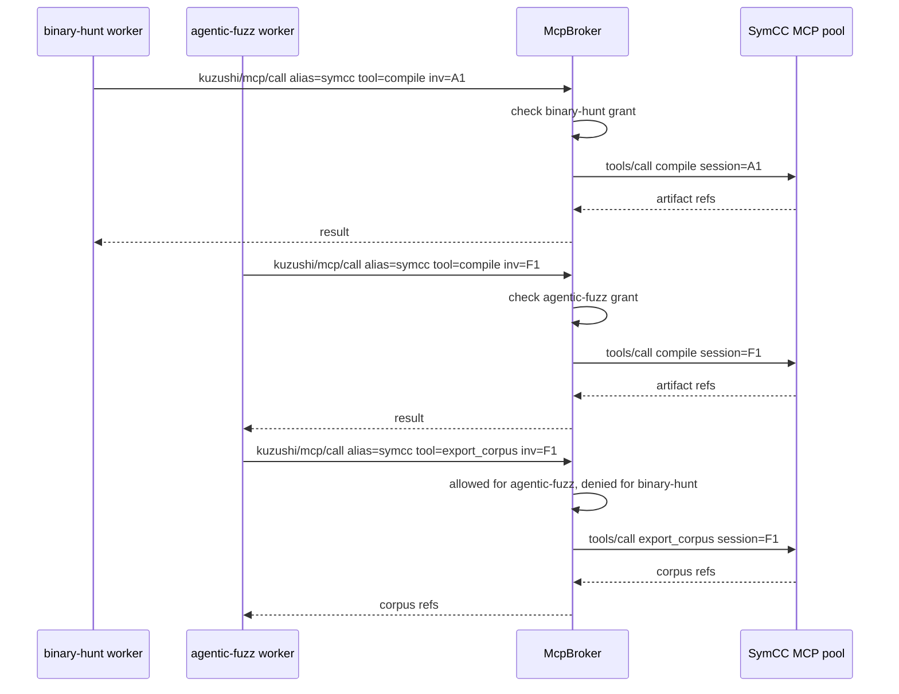
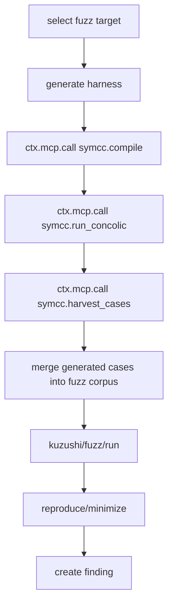

# MCP Composition over KWP

Status: design plus first-pass implementation. Local `file://` KWP Node
workers can call operator-configured stdio MCP mounts through
`kuzushi/mcp/call`; the host enforces alias/tool grants, validates the mounted
server descriptor hash, scopes calls with a host-derived session id, and
verifies returned artifact refs. Shared pools, container-backed mounts,
descriptor approval UX, deadlines, and richer audit records remain planned.

This document describes how KWP-backed modules compose shared MCP servers. The motivating case is a `symcc` MCP server used by more than one module: for example, a low-level binary analysis module and the `agentic-fuzz:hunt` module both want to compile/run SymCC-instrumented targets and harvest generated test cases.

The short version: MCP servers are **host-mounted capabilities**, not module-owned dependencies. A module does not spawn or connect to `symcc` directly. The module asks the KWP broker to call a granted MCP alias. The host owns MCP lifecycle, trust, multiplexing, quotas, session isolation, and audit.

## 1. Why MCP composition belongs in the host

If modules directly connect to MCP servers, then MCP becomes an untracked privilege escalation path:

- the module can reach tools outside its grant;
- the MCP server may see raw workspace paths;
- multiple modules can contaminate each other's state;
- tool descriptors can change after approval;
- costs, files, network, and subprocesses happen outside KWP audit.

So MCP composition follows the same rule as filesystem, runtime, network, artifacts, findings, and fuzz execution: every privileged effect flows through the broker.



## 2. Core concepts

### 2.1 Mounted MCP server

A mounted MCP server is a host-managed process, container, remote endpoint, or adapter with a stable alias:

```text
symcc
```

The alias is a capability name. It is not a network address and not a package name.

Mount records are content-addressed when the MCP server is local/container-backed:

```ts
interface McpMount {
  alias: string;
  kind: "stdio" | "container" | "remote" | "adapter";
  descriptorHash: `sha256:${string}`;
  imageDigest?: `sha256:${string}`;
  commandDigest?: `sha256:${string}`;
  endpoint?: string;
  tools: McpToolDescriptor[];
  defaultIsolation: "shared-process-isolated-session" | "dedicated-process";
}
```

Remote MCP servers still need an approval record, but the trust anchor is weaker unless the transport is authenticated and descriptor-pinned. For security tooling such as SymCC, prefer container-backed mounts.

The current stdio implementation is configured in operator-owned config:

```toml
[[operator.mcp_mounts]]
alias = "symcc"
command = ["kuzushi-mcp-symcc"]
descriptor_hash = "sha256:..."

[[operator.mcp_mounts.tools]]
name = "compile"
description = "Compile a harness with SymCC instrumentation"
input_schema = { type = "object" }
output_schema = { type = "object" }
```

Target-local project config cannot define `operator.mcp_mounts`.

### 2.2 MCP grant

Modules receive grants to a mounted MCP alias and a subset of its tools:

```ts
interface McpGrant {
  alias: string;                         // "symcc"
  tools: string[];                       // allowlist: "compile", "run", "harvest_cases"
  mode: "shared" | "dedicated";         // shared process with isolated sessions, or per-module process
  maxCallsPerInvocation?: number;
  maxCpuSecondsPerInvocation?: number;
  maxBytesPerInvocation?: number;
  maxArtifactsBytesPerInvocation?: number;
  workspace: "read-only" | "scratch-only" | "read-write";
}

interface Grant {
  // existing KWP grant fields...
  mcp?: McpGrant[];
}
```

A module can only call MCP tools named in its grant. Tool annotations/descriptions are treated as untrusted data; authorization is by grant, not by MCP metadata.

### 2.3 MCP session

A session is a host-side isolation context:

```ts
interface McpSessionKey {
  alias: string;
  moduleId: string;
  moduleDigest: string;
  runId: string;
  invocationId: string;
}
```

By default, MCP calls use a per-invocation session. The MCP server process may be shared, but mutable state, scratch paths, caches, and roots are scoped by session.

Two modules using `symcc` share the expensive server pool but not writable state.

## 3. Protocol extension

KWP adds one broker method:

```text
kuzushi/mcp/call
```

Request:

```jsonc
{
  "invocationId": "inv_...",
  "alias": "symcc",
  "tool": "compile",
  "arguments": {
    "target": "src/parser.c",
    "harness": "agentic-fuzz/harnesses/parser_harness.c",
    "output": "agentic-fuzz/symcc/parser"
  },
  "limits": {
    "deadlineMs": 120000,
    "cpuSeconds": 240,
    "artifactBytes": 268435456
  }
}
```

Response:

```jsonc
{
  "content": [
    { "type": "text", "text": "compiled parser with SymCC instrumentation" }
  ],
  "structuredContent": {
    "artifacts": [
      { "path": "agentic-fuzz/symcc/parser/instrumented", "mediaType": "application/octet-stream" }
    ],
    "metadata": {
      "mcpAlias": "symcc",
      "tool": "compile",
      "sessionId": "mcp_sess_..."
    }
  }
}
```

The worker SDK exposes this as:

```ts
const compiled = await ctx.mcp.call("symcc", "compile", {
  target: "src/parser.c",
  harness: "agentic-fuzz/harnesses/parser_harness.c",
  output: "agentic-fuzz/symcc/parser"
});
```

The host validates `alias`, `tool`, `arguments`, limits, and artifact refs. The MCP server's own schema can help validate arguments, but the host-side compiled descriptor is the authority.

## 4. Host components



### 4.1 `McpCatalog`

Stores mounted MCP descriptors:

```ts
interface McpCatalogEntry {
  alias: string;
  digestOrEndpoint: string;
  descriptorHash: string;
  tools: Record<string, CompiledSchema>;
  outputSchemas: Record<string, CompiledSchema | undefined>;
  isolation: McpIsolationPolicy;
}
```

The descriptor is pinned at approval time. If `tools/list` changes, the host rejects the mount until re-approved.

### 4.2 `McpSupervisor`

Owns MCP server lifecycle. It is separate from module worker supervision because many modules can use one MCP server.

Responsibilities:

- spawn/connect after trust verification;
- perform MCP `initialize` and `tools/list`;
- compare descriptor hash to approval;
- pool shared servers;
- create per-invocation sessions;
- enforce timeout and recycle policy;
- kill/restart unhealthy servers.

### 4.3 `McpBroker`

The `McpBroker` is called by `CapabilityBroker` or as a sibling broker. It follows the same enforcement path:

```text
ensure active invocation
ensure epoch current
check module grant for alias/tool
validate arguments against pinned schema
allocate/get session
call MCP tool
validate result/artifact refs
meter CPU/bytes/calls
append audit record
return result
```

## 5. Sharing model

There are three sharing levels.

### 5.1 Shared process, isolated session — default

Use this for expensive but session-safe MCP servers.

```text
one symcc MCP process/container pool
many module invocations
per-invocation scratch dirs and session ids
shared read-only cache allowed
no shared writable corpus/crash dirs
```

This is the recommended mode for SymCC if the server can accept per-call work directories.

### 5.2 Dedicated process per module

Use when the MCP server has unavoidable global mutable state.

```text
symcc process for module A
symcc process for agentic-fuzz
separate caches, separate scratch, more overhead
```

### 5.3 Dedicated process per invocation

Use for high-risk or non-reentrant servers.

```text
spawn symcc MCP for this invocation only
kill after call/tool sequence
highest isolation, highest overhead
```

The grant chooses `mode`, but the host may always strengthen isolation.

## 6. SymCC as a mounted MCP

SymCC is a compiler-based symbolic execution system: the compiler pass instruments the program during compilation, and the runtime support library computes symbolic expressions during execution. SymCC can also be combined with fuzzing to generate new test cases.

Model it as a container-backed MCP mount:

```yaml
mcpMounts:
  symcc:
    kind: container
    image: ghcr.io/kuzushi/symcc-mcp@sha256:...
    descriptorHash: sha256:...
    isolation: shared-process-isolated-session
    tools:
      - compile
      - run_concolic
      - harvest_cases
      - minimize_case
      - export_corpus
```

Suggested SymCC MCP tools:

```text
symcc.compile
  input: source/harness refs, compiler flags, output path
  output: instrumented binary artifact

symcc.run_concolic
  input: instrumented binary artifact, seed input/corpus, time limit
  output: generated test cases, trace/log artifacts

symcc.harvest_cases
  input: output dir from run_concolic
  output: corpus artifact refs

symcc.minimize_case
  input: binary + candidate input
  output: minimized input + reproduction log

symcc.export_corpus
  input: generated cases
  output: corpus directory artifact for downstream fuzzing
```

## 7. Example: two modules using SymCC

### 7.1 Grants

Module A:

```jsonc
{
  "moduleId": "binary-hunt",
  "mcp": [
    {
      "alias": "symcc",
      "tools": ["compile", "run_concolic", "harvest_cases"],
      "mode": "shared",
      "workspace": "scratch-only",
      "maxCpuSecondsPerInvocation": 300
    }
  ]
}
```

Agentic fuzzing module:

```jsonc
{
  "moduleId": "agentic-fuzz",
  "mcp": [
    {
      "alias": "symcc",
      "tools": ["compile", "run_concolic", "harvest_cases", "export_corpus"],
      "mode": "shared",
      "workspace": "scratch-only",
      "maxCpuSecondsPerInvocation": 600,
      "maxArtifactsBytesPerInvocation": 536870912
    }
  ]
}
```

Both modules use the same mounted alias, but each call is evaluated against the caller's own grant.

### 7.2 Sequence



The same SymCC server pool can serve both modules, but authorization, quotas, artifacts, and audit records remain per invocation.

## 8. Agentic fuzzing integration

`agentic-fuzz:hunt` can use SymCC as an optional accelerator:



The module decides when SymCC is useful. The host decides whether the module is allowed to call it.

Example worker code:

```ts
if (ctx.mcp.has("symcc")) {
  ctx.reportActivity("compiling harness with SymCC");
  const compiled = await ctx.mcp.call("symcc", "compile", {
    target: selected.sourcePath,
    harness: harness.path,
    output: `agentic-fuzz/symcc/${selected.id}`
  });

  ctx.reportActivity("running concolic exploration");
  const cases = await ctx.mcp.call("symcc", "run_concolic", {
    binary: compiled.structuredContent.artifacts[0].path,
    seedCorpus: corpus.path,
    output: `agentic-fuzz/corpus/${selected.id}/symcc`,
    deadlineMs: 120000
  });

  await mergeCorpus(cases, corpus);
}
```

If the grant does not include SymCC, `ctx.mcp.has("symcc")` is false and the module falls back to ordinary fuzzing.

## 9. MCP descriptors are not prompts

MCP tool descriptions are untrusted. The host may show them to operators, but modules should not blindly inject them into prompts. The approved descriptor hash protects against descriptor rug-pulls; semantic poisoning is still possible, so modules should call MCP tools by explicit alias/tool names from their own policy, not by letting an LLM dynamically choose from arbitrary MCP descriptions.

For `agentic-fuzz:hunt`, the policy is explicit:

```text
Allowed optional MCP accelerators:
  symcc.compile
  symcc.run_concolic
  symcc.harvest_cases
  symcc.export_corpus
```

The LLM may propose target/harness strategy, but it does not get to select new MCP capabilities outside the grant.

## 10. Result and artifact ownership

Artifacts produced by MCP tools are owned by the caller invocation, not by the MCP server globally.

For example:

```text
agentic-fuzz/symcc/<target-id>/instrumented
agentic-fuzz/corpus/<target-id>/symcc/*
binary-hunt/symcc/<target-id>/cases/*
```

The MCP server returns artifact references; the host verifies and hashes them before passing them back to the module.

## 11. Audit

Each MCP call emits records like:

```jsonc
{
  "event": "mcp.call",
  "decision": "allow",
  "moduleId": "agentic-fuzz",
  "digest": "sha256:module...",
  "invocationId": "inv_...",
  "detail": {
    "alias": "symcc",
    "tool": "run_concolic",
    "mcpDescriptorHash": "sha256:...",
    "sessionId": "mcp_sess_...",
    "cpuSeconds": 83,
    "artifactBytes": 10485760
  },
  "prev": "sha256:..."
}
```

Denied calls are also audited:

```jsonc
{
  "event": "mcp.call",
  "decision": "deny",
  "moduleId": "binary-hunt",
  "detail": {
    "alias": "symcc",
    "tool": "export_corpus",
    "reason": "tool not granted"
  }
}
```

## 12. Required host-side tests

- A module without `mcp` grant cannot call `kuzushi/mcp/call`.
- A module granted `symcc.compile` cannot call `symcc.export_corpus`.
- Two modules sharing `symcc` get distinct session ids and scratch directories.
- Descriptor hash drift disables the mount until re-approved.
- MCP artifact path escape is rejected.
- MCP server crash does not kill module worker or TUI.
- Deadline cancels the MCP call and deactivates the invocation.
- Epoch bump drops late MCP results.
- Shared read-only cache is allowed; shared writable corpus is denied unless explicitly configured.
- MCP tool descriptions are never used as authorization input.

## 13. Decision

MCP composition is supported by adding an MCP broker layer under KWP:

```text
module worker -> KWP -> McpBroker -> mounted MCP server
```

`SymCC` should be mounted once as a host-owned MCP capability. `binary-hunt`, `agentic-fuzz`, and future modules receive independent grants to the same `symcc` alias. Calls share a server pool when safe, but authority, session state, artifacts, quotas, and audit records remain per module invocation.
