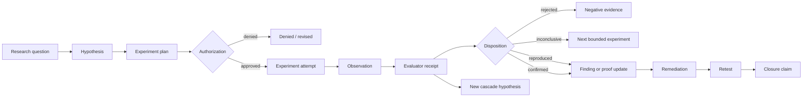

# Product Workflow — Kuzushi Security Research Control Plane

> **Status:** proposal for review
> **Date:** 2026-08-19
> **Plan index:** [security research control-plane productization](./README.md)
> **Roadmap constraint:** the current [ROADMAP](../../../ROADMAP.md) remains authoritative.

---

## 1. Target users and jobs to be done

### 1.1 Primary user: senior AppSec or product-security engineer

They are investigating a difficult repository-centered security question and need a result that can survive review.

Jobs:

- turn several noisy scanner/model outputs into one defensible conclusion;
- prove or reject attacker reachability;
- explain exactly why a finding is or is not confirmed;
- preserve the work so another engineer can continue it;
- generate a remediation plan and verify closure;
- account for cost and time;
- avoid granting broad authority to an autonomous agent.

### 1.2 Vulnerability researcher

They start from an observation and iteratively design experiments.

Jobs:

- capture a hypothesis without losing the inspiration source;
- state what would falsify it;
- run several bounded experiments;
- keep negative and inconclusive evidence;
- branch from a successful observation;
- distinguish local harness behavior from real attack surface;
- publish a reproducible artifact bundle.

### 1.3 Security platform or detection engineer

They maintain engines, policies, and benchmarks.

Jobs:

- integrate a specialist engine without giving it ownership of Kuzushi truth;
- compare backends on the same corpus;
- see where candidates disappear;
- identify observation blind spots;
- prevent benchmark regressions;
- version evaluators and policies;
- know when an engine changed a proof outcome.

### 1.4 Security lead or reviewer

They need governance and portfolio visibility without reading raw agent transcripts.

Jobs:

- review the question, evidence, authority, and remaining uncertainty;
- approve dangerous experiments or deny them;
- see which claims are stale;
- compare cost and verified yield;
- export a signed or digest-bound review package;
- distinguish a model opinion from an empirical or formal witness.

### 1.5 AI-agent platform security engineer, later

They investigate agent/tool/credential paths and runtime trajectories.

Jobs:

- map delegated authority;
- determine whether a sequence of allowed actions becomes a policy violation;
- replay a malicious trajectory;
- inspect startup configuration and tool provenance;
- verify a remediation across the same path.

This persona is strategically relevant, but it should not pull the first release away from repository security.

---

## 2. Product promise and non-goals

### 2.1 Product promise

For every material security claim, Kuzushi should be able to show:

1. the question and hypothesis;
2. the target identity;
3. the observation boundary;
4. the authority manifest;
5. the exact experiment plan and approval;
6. the backend and evaluator identities;
7. the observations and artifacts;
8. the evaluator outcome;
9. the proof dimensions changed;
10. the human decision;
11. the remediation and retest result;
12. the cost, latency, and failure accounting;
13. the remaining uncertainty.

### 2.2 Non-goals

Kuzushi should not:

- become a generic coding assistant;
- store hidden chain-of-thought or raw model transcripts as research state;
- let a model or plugin mark its own hypothesis confirmed;
- make “multi-agent consensus” a substitute for runtime or formal evidence;
- expose arbitrary shell execution as a research backend;
- create a second mutable source of truth beside the V3 event log;
- replace findings with a new generic “claim” object;
- add a new top-level workflow for each research domain;
- promise full coverage when the observation boundary is partial;
- conflate “not rediscovered” with “fixed”;
- ship a broad external attack surface before the repository-security benchmark is credible;
- require a Kuzushi cloud service for local evidence and replay;
- create a plugin marketplace before the backend trust contract and conformance corpus exist.

---

## 3. End-to-end product workflow

### 3.1 Canonical lifecycle



### 3.2 Example: repository finding

1. A scan creates or corroborates finding `F-0042`.
2. The operator opens a research case: “Can untrusted HTTP input reach the unsafe deserializer in `parser.rs`?”
3. A model proposes a hypothesis and a static path experiment.
4. The operator accepts the hypothesis; the host records the exact falsification predicate.
5. Existing CPG/CodeQL/static tools execute under the normal module registry.
6. The experiment records the repository snapshot, observed files, parser/index coverage, tool versions, warnings, and skipped surfaces.
7. A host evaluator decides whether the path predicate was met.
8. The hypothesis becomes `reproduced_static`, not “exploitable.”
9. A second experiment uses the existing runtime proof path.
10. A sanitizer witness reproduces a crash in a local harness.
11. Proof changes: execution witness = sanitizer crash; reachability = local harness only; exploitability = not established.
12. A third experiment establishes attacker-controlled entrypoint reachability.
13. The finding report now says exactly what is proven and what remains unknown.
14. A patch is applied.
15. Retest executes the same experiments and records which predicates no longer hold.

### 3.3 Negative results are product value

A rejected hypothesis is not deleted and is not a failed run.

It should retain:

- why the hypothesis was plausible;
- what experiment was run;
- what was visible;
- which evaluator rejected it;
- whether the result is stable or environment-specific;
- when it expires or needs revalidation;
- whether it narrows the next hypothesis.

This prevents repeated dead-end work and makes research transferable.

---

## 4. Operator experience

### 4.1 Preserve the current phase cockpit

Do not add a six- or seven-phase primary rail.

Research should project through the current phases:

| Current phase | Research projection |
| --- | --- |
| Map | question context, target identity, observation boundary, startup authority, attack surface |
| Scan | active hypotheses, planned/running experiments, candidate funnel |
| Review | dispositions, disagreements, negative evidence, human decisions |
| Prove | evaluator receipts, witnesses, reachability, exploitability, exposure, impact |
| Fix | remediation attempts and exact re-experiment plan |
| Report/export | full lineage, remaining uncertainty, reproducibility manifest |

A dedicated Research view may later aggregate these objects, but it should not redefine the journey.

### 4.2 CLI-first surface

The first productized surface should be headless and scriptable.

Illustrative commands—not yet a compatibility promise:

```text
kuzushi research start --target . --question "Can untrusted input reach parser X?"
kuzushi research list --target .
kuzushi research show RQ-0001 --target .
kuzushi research tree RQ-0001 --target .
kuzushi research hypothesis propose RQ-0001 --statement "..." --falsified-by "..."
kuzushi research hypothesis accept H-0001
kuzushi research experiment plan H-0001 --tool taint-iris-next:hunt --input plan.json
kuzushi research experiment run E-0001
kuzushi research disposition H-0001 --verdict inconclusive --reason "..."
kuzushi research export RQ-0001 --format markdown-bundle --out research/
```

The earliest implementation can be smaller:

```text
research list
research show
research tree
```

Creation may initially happen through a single built-in tool or structured JSON input to keep the command surface narrow.

### 4.3 Research tree projection

The operator needs a compact projection:

```text
RQ-0001 Can attacker input reach unsafe deserialization?  OPEN
├─ H-0001 HTTP body reaches parse_message                  REPRODUCED_STATIC
│  ├─ E-0001 CPG path query                                SATISFIED
│  └─ E-0002 source review                                 SATISFIED
├─ H-0002 path is remotely triggerable                     INCONCLUSIVE
│  ├─ E-0003 local harness                                 CRASH_OBSERVED
│  └─ E-0004 route integration                             BLOCKED: fixture missing
└─ H-0003 size check prevents controlled overwrite         REJECTED
   └─ E-0005 boundary-value execution                      FALSIFIED
```

Every status must derive from durable events, not transient TUI state.

### 4.4 Finding detail integration

A finding detail should show:

```text
Research lineage
  Question: RQ-0001
  Hypotheses: 3
  Confirmed/reproduced: 1
  Rejected: 1
  Inconclusive: 1

Proof
  Static: source_sink_linked
  Execution witness: sanitizer_crash
  Reachability: local_harness_only
  Exploitability: uncontrolled_corruption
  Exposure: unknown

Boundary
  Source: 97.4% indexed, generated code excluded
  Runtime: local harness only
  Network: not observed
  Deployment: not observed

Next action
  Establish route-to-harness input equivalence
```

### 4.5 Dangerous experiments remain explicit

Any experiment whose prepared tool effect is:

- `target-write`;
- `repository-execute`;
- `external-action`;
- network-enabled fuzzing;
- a malicious peer;
- credential use;
- deployment mutation;

must use the existing explicit authorization path. A research plan is not authorization.

---
