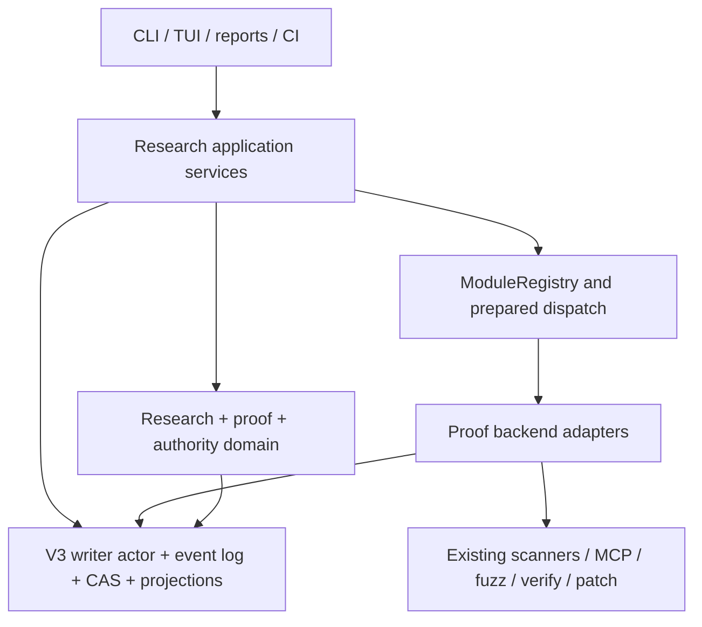

# Domain Model — Kuzushi Security Research Control Plane

> **Status:** proposal for review
> **Date:** 2026-08-19
> **Plan index:** [security research control-plane productization](./README.md)
> **Roadmap constraint:** the current [ROADMAP](../../../ROADMAP.md) remains authoritative.

---

## 1. Product architecture

### 1.1 Layered design



### 1.2 Ownership rule

Kuzushi core owns:

- identifiers;
- state transitions;
- validation;
- authorization linkage;
- observation-boundary schema;
- evaluator-receipt schema;
- proof transitions;
- artifact normalization;
- event append;
- projection;
- replay;
- reports;
- cost and terminal accounting.

Specialist backends own:

- protocol grammars;
- browser automation;
- fuzzing mechanics;
- symbolic execution;
- binary lifting;
- query languages;
- exploit construction;
- target-specific harnesses.

A backend returns observations and proposed claims. The host decides what enters durable state.

### 1.3 Proposed bounded context

Suggested initial layout:

```text
crates/kuzushi-core/src/research/
  domain/
    ids.rs
    question.rs
    hypothesis.rs
    experiment.rs
    observation.rs
    evaluator_receipt.rs
    disposition.rs
    cascade.rs
    observation_boundary.rs
  application/
    create_question.rs
    propose_hypothesis.rs
    plan_experiment.rs
    record_observation.rs
    apply_evaluator_receipt.rs
    record_disposition.rs
    project_research_tree.rs
  persistence/
    events.rs
    projection.rs
    queries.rs
  presentation/
    summary.rs
    tree.rs
    export.rs
```

Do not create generic repository/service/factory layers unless a real boundary requires them. Follow the repository DDD guidance: pure domain types, application orchestration, IO at adapters, presentation DTOs.

### 1.4 Integration points

| Existing component | Integration |
| --- | --- |
| `ModuleRegistry::prepare_dispatch_input` | canonical experiment tool input and policy resolution |
| observed dispatch path | experiment attempt lifecycle and effect receipts |
| V3 writer actor | only durable commit path |
| target-wide event log | research and proof semantic events |
| per-run `items.jsonl` | bounded lifecycle references and evaluator receipts |
| CAS | large observations, traces, harnesses, screenshots, protocol captures |
| SQLite | disposable research tree, query, and summary projection |
| findings domain | links research claims to durable finding identity |
| static proof state | preserved; extended by orthogonal runtime dimensions |
| strategy queue | later source of proposed hypotheses/experiment plans |
| spend ledger | experiment and proof-upgrade cost attribution |
| exports | research bundle and finding-linked lineage |

---

## 2. Domain model

### 2.1 Identifiers

Identifiers must be host-issued, stable, bounded, and unguessable enough to avoid accidental collision. Display aliases may be human-friendly.

```rust
pub struct ResearchQuestionId(String); // rq_...
pub struct HypothesisId(String);       // hyp_...
pub struct ExperimentPlanId(String);   // exp_...
pub struct ExperimentAttemptId(String);// att_...
pub struct ObservationId(String);      // obs_...
pub struct EvaluatorReceiptId(String); // eval_...
pub struct CascadeEdgeId(String);      // cas_...
```

The canonical ID must not depend on model prose. An optional semantic digest may support deduplication, but it must not replace identity.

### 2.2 Research question

```rust
pub struct ResearchQuestion {
    pub id: ResearchQuestionId,
    pub target: TargetIdentity,
    pub title: BoundedText,
    pub scope: ResearchScope,
    pub created_by: AuthorityPrincipal,
    pub created_at: Timestamp,
    pub status: ResearchQuestionStatus,
    pub linked_findings: Vec<FindingIdentityId>,
}
```

Statuses:

```rust
pub enum ResearchQuestionStatus {
    Open,
    Paused,
    Resolved,
    ClosedWithoutResolution,
}
```

A question is resolved only through an explicit human or policy-owned decision referencing the supporting hypothesis dispositions. A model cannot resolve it.

### 2.3 Hypothesis

```rust
pub struct ResearchHypothesis {
    pub id: HypothesisId,
    pub question_id: ResearchQuestionId,
    pub statement: BoundedText,
    pub inspired_by: Vec<EvidenceRef>,
    pub falsification: FalsificationPredicate,
    pub expected_observations: Vec<ExpectedObservation>,
    pub proposed_by: AuthorityPrincipal,
    pub accepted_by: Option<AuthorityPrincipal>,
    pub status: HypothesisStatus,
}
```

Statuses:

```rust
pub enum HypothesisStatus {
    Proposed,
    Accepted,
    RejectedBeforeExperiment,
    Active,
    Reproduced,
    Confirmed,
    Falsified,
    Inconclusive,
    Superseded,
    Expired,
}
```

`Reproduced` means a declared predicate was repeatedly observed. `Confirmed` should be reserved for a stronger domain-defined evaluator contract. The initial release may omit `Confirmed` rather than use it loosely.

### 2.4 Falsification predicate

Free-form prose alone is insufficient. A predicate has a typed evaluator plus a bounded explanation.

```rust
pub struct FalsificationPredicate {
    pub evaluator: EvaluatorSpec,
    pub success_condition: PredicateExpression,
    pub falsified_when: PredicateExpression,
    pub inconclusive_when: Vec<InconclusiveCondition>,
    pub rationale: BoundedText,
}
```

Examples:

- no source-to-sink path exists under the declared CPG snapshot;
- a sanitizer crash cannot be reproduced in three attempts;
- a browser effect is absent after the exact interaction sequence;
- the target rejects an adversarial protocol transition without writing outside the allowed root;
- a deployment endpoint is not reachable from the declared vantage point.

The predicate language should begin with a small closed set. Do not invent a general-purpose expression runtime in v1.

### 2.5 Experiment plan

```rust
pub struct ExperimentPlan {
    pub id: ExperimentPlanId,
    pub hypothesis_id: HypothesisId,
    pub tool: ToolIdentity,
    pub canonical_input_digest: Digest,
    pub target: TargetIdentity,
    pub observation_boundary: ObservationBoundary,
    pub requested_authority: RequestedAuthority,
    pub expected_artifacts: Vec<ArtifactExpectation>,
    pub evaluator: EvaluatorSpec,
    pub repetition: RepetitionPolicy,
    pub budget: ExperimentBudget,
    pub created_by: AuthorityPrincipal,
    pub status: ExperimentPlanStatus,
}
```

The complete canonical input remains an artifact where appropriate. Events retain bounded semantics and digests.

Plan statuses:

```rust
pub enum ExperimentPlanStatus {
    Draft,
    ReadyForAuthorization,
    Authorized,
    Denied,
    Superseded,
    Exhausted,
}
```

### 2.6 Experiment attempt

```rust
pub struct ExperimentAttempt {
    pub id: ExperimentAttemptId,
    pub plan_id: ExperimentPlanId,
    pub run_id: RunId,
    pub target: TargetIdentity,
    pub authority_manifest: AuthorityManifestRef,
    pub started_at: Timestamp,
    pub terminal: Option<ExperimentTerminal>,
}
```

Terminal outcomes:

```rust
pub enum ExperimentTerminal {
    Completed,
    Partial,
    Blocked,
    Failed,
    Canceled,
    Interrupted,
    Skipped,
}
```

The research projection must reuse the canonical run outcome rather than inventing a divergent status.

### 2.7 Observation

```rust
pub struct ResearchObservation {
    pub id: ObservationId,
    pub attempt_id: ExperimentAttemptId,
    pub kind: ObservationKind,
    pub summary: BoundedText,
    pub evidence: Vec<EvidenceRef>,
    pub boundary_ref: ObservationBoundaryRef,
    pub producer: ArtifactIdentity,
    pub observed_at: Timestamp,
}
```

An observation records what happened. It does not decide the hypothesis.

Candidate kinds may include:

```rust
pub enum ObservationKind {
    StaticPath,
    SourceInvariant,
    RuntimeCrash,
    RuntimeEffect,
    BrowserEffect,
    ProtocolTrace,
    FormalWitness,
    ExposurePath,
    PolicyBlock,
    NegativeResult,
    InfrastructureFailure,
}
```

Only the subset needed by the first vertical slice should ship initially.

### 2.8 Evaluator receipt

```rust
pub struct EvaluatorReceipt {
    pub id: EvaluatorReceiptId,
    pub attempt_id: ExperimentAttemptId,
    pub evaluator: ArtifactIdentity,
    pub evaluator_policy_digest: Digest,
    pub input_artifacts: Vec<EvidenceRef>,
    pub boundary_ref: ObservationBoundaryRef,
    pub outcome: EvaluatorOutcome,
    pub reasons: Vec<EvaluatorReason>,
    pub deterministic: bool,
    pub evaluated_at: Timestamp,
}
```

Outcomes:

```rust
pub enum EvaluatorOutcome {
    PredicateSatisfied,
    PredicateFalsified,
    Inconclusive,
    InvalidExperiment,
    EvidenceUnavailable,
}
```

The evaluator receipt is the only input allowed to promote a hypothesis disposition automatically.

A model may be part of an evaluator pipeline, but a model-only result must be labeled non-deterministic and capped below empirical/formal proof. A multi-model vote does not become deterministic by repetition.

### 2.9 Disposition

```rust
pub struct HypothesisDisposition {
    pub hypothesis_id: HypothesisId,
    pub status: HypothesisStatus,
    pub evaluator_receipts: Vec<EvaluatorReceiptId>,
    pub decided_by: AuthorityPrincipal,
    pub reason: BoundedText,
    pub decided_at: Timestamp,
    pub expires_at: Option<Timestamp>,
}
```

Machine-applied dispositions must name a host policy principal. Human overrides append a new decision; they do not rewrite the evaluator receipt.

### 2.10 Cascade edge

```rust
pub struct ResearchCascadeEdge {
    pub id: CascadeEdgeId,
    pub from_observation: ObservationId,
    pub to_hypothesis: HypothesisId,
    pub rationale: BoundedText,
    pub proposed_by: AuthorityPrincipal,
    pub accepted_by: Option<AuthorityPrincipal>,
}
```

This is the durable form of “that result suggests we should test X next.”

It stores a bounded rationale and evidence references, never hidden reasoning.

---

## 3. Domain invariants

The first implementation must enforce these invariants in pure domain code and at the persistence boundary.

### 3.1 Truth ownership

- A backend may emit observations and proposed findings.
- A backend may not assign canonical finding identity.
- A backend may not write research events directly.
- A backend may not mark a hypothesis reproduced, confirmed, or falsified.
- A model may propose a hypothesis or plan.
- A model-only assessment may not create an empirical witness.
- Only the host writer actor commits durable research state.

### 3.2 Evaluator integrity

- Every automated disposition references at least one evaluator receipt.
- Every evaluator receipt references exact input artifacts and an observation boundary.
- An evaluator cannot evaluate evidence produced after its receipt timestamp.
- Unknown or unavailable evidence yields `Inconclusive` or `EvidenceUnavailable`, never success.
- An unsupported evaluator version fails closed.
- Contradictory evaluator receipts remain visible; they are not averaged into certainty.
- A later receipt appends; it does not mutate an earlier receipt.

### 3.3 Experiment integrity

- Every attempt belongs to exactly one plan and one canonical run.
- A plan's prepared tool identity and canonical input digest are immutable after authorization.
- Revisions create a new plan identity.
- Authorization binds the plan, target identity, requested authority, and policy digest.
- A stale authorization cannot be reused after a material plan or target change.
- Cancellation and interruption remain terminal and cannot be relabeled as completed.
- A run may finish while an experiment is still invalid due to missing evidence; execution success is not evaluator success.

### 3.4 Boundary honesty

- Every evaluator receipt references one complete observation boundary.
- Required but unobserved surfaces force a downgrade or invalid experiment.
- A “clean” result always means “no predicate-satisfying observation within this boundary.”
- Parser/index/tool failures are part of the boundary.
- A partial boundary cannot be silently promoted to complete.
- Boundary completeness is dimensioned; it is not one unqualified percentage.

### 3.5 Research lineage

- Every hypothesis belongs to one question.
- Every accepted hypothesis has a falsification predicate.
- Every cascade edge cites an originating observation.
- Every terminal hypothesis has a reason.
- Superseding a hypothesis preserves the old branch.
- Closing a question requires an explicit decision and remaining-uncertainty summary.
- Deleting durable research history is not a normal operation.

### 3.6 Privacy and bounded content

- Do not persist raw prompts, raw model responses, hidden reasoning, credentials, or unrestricted stdout/stderr in semantic events.
- Store bounded summaries and artifact references.
- Secret-looking values are redacted or represented only by set/unset and digest policy.
- All free-form text uses the existing redaction, control escaping, and size bounds.
- Large traces, corpora, screenshots, binaries, and captures live in CAS or declared artifacts.

---
